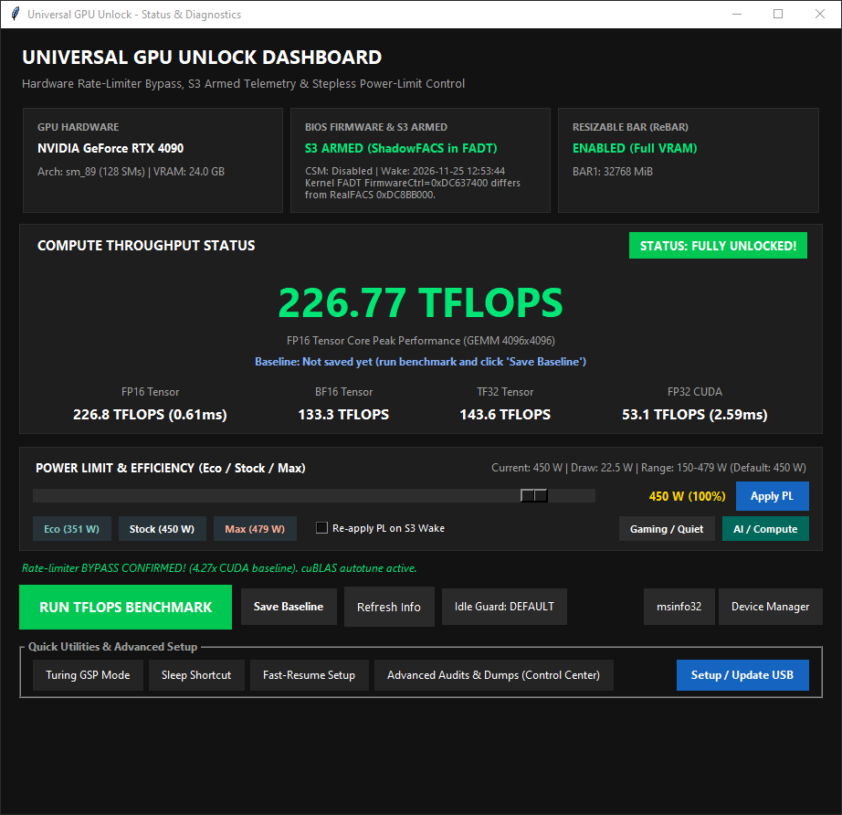

<div align="center">

# Universal GPU Unlock (One-Click UEFI Tool)
### High-Performance Tensor Core Rate-Limiter Bypass for NVIDIA GPUs

[](https://github.com/BrightRaider/universal-gpu-unlock/releases/latest)
[](https://github.com/BrightRaider/universal-gpu-unlock/releases/tag/v2.0.0)
[](https://github.com/BrightRaider/universal-gpu-unlock/releases)
[](https://github.com/BrightRaider/universal-gpu-unlock)
[](#-safety--anti-cheat)
[](https://ko-fi.com/brightraider)

<br>

<a href="https://ko-fi.com/brightraider" target="_blank">
  
</a>

<p>
  <b>Universal 1-click UEFI Tensor Core unlocker for NVIDIA RTX 40 (Ada), RTX 30 (Ampere) &amp; RTX 20 (Turing) GPUs.</b><br>
  <b>Persistent ACPI S3 Sleep</b> · Stickless Auto-Unlock · Secure Boot &amp; Vanguard Ready · PyTorch, CUDA &amp; WSL2.
</p>

<br>



</div>

---

## ⚡ 60-Second Quick Start

1. **Prepare (`Setup.bat`):** Download & extract **[Universal_GPU_Unlock_v2.0.0.zip](https://github.com/BrightRaider/universal-gpu-unlock/releases/latest)**, insert a FAT32 USB drive, and run `Setup.bat`:
   - `[1]` **New USB setup** *(with automatic BitLocker / Secure Boot / S0ix pre-flight checks)*
   - `[2]` **Update existing USB**
   - `[3]` **Create hidden `512 MB` `GPU_UNLOCK` partition** *(optional — enables stickless boot on `100 MB` Windows ESPs)*
2. **Boot & Unlock:** Restart from the USB drive (`F8` / `F11` / `F12`) and press one key *(press `[Space]` anytime to pause the 30s menu timer)*:
   - `[U]` **Standard Unlock:** Volatile RAM-only unlock (reverts cleanly to stock on power-off).
   - `[P]` **S3 Persistence:** Keeps the unlock active across Windows Sleep / Standby (ACPI S3).
   - `[I]` **Stickless Auto-Unlock (`NVRAM`):** Installs `AdaUnlockDxe.efi` (`Driver####`) so Windows unlocks automatically on cold boots and survives ACPI S3 sleep — no USB drive required afterward.
   - `[R]` **Remove DXE Driver:** Cleanly uninstalls `[I]` from UEFI NVRAM and internal partitions.
   - `[S]` **Stock Windows:** Diagnostic scan & log only (boots stock).
3. **Verify & Control:** In Windows, run **`Launch-Dashboard.bat`** (GUI Cockpit: live `S3 ARMED` indicator, 1-W power-limit slider with S3-wake re-apply, baseline comparison) or **`Check-GPU-Unlock.bat`** (CLI benchmark & `FMLA32/16` check).

> [!TIP]
> **First-Boot Checklist:** Set **CSM = Disabled** (Pure UEFI) in your BIOS to avoid blank screens or Error 43, and enable **Above 4G Decoding** + **Resizable BAR** for full memory throughput (+10% to +15%).

---

## 🔒 Secure Boot & Anti-Cheat

- **Without Anti-Cheat (easiest):** Temporarily set **Secure Boot** to **Disabled** (or *Other OS*) in BIOS.
- **Keep Secure Boot enabled (Windows 11):** In BIOS under **Security ➔ Secure Boot ➔ Key Management ➔ Authorized Signatures (`db`)**, select **Append / Enroll DB Key**, choose `AdaUnlock_SecureBoot.cer` from your USB drive, and save (`F10`). *(Always **append** — never delete existing Microsoft/OEM factory keys!)*

### Riot Vanguard (*Valorant* / *League of Legends*)

1. **Keep Secure Boot enabled** with factory keys intact *(append `AdaUnlock_SecureBoot.cer` to `db` only if your BIOS blocks the unsigned drive/driver)*.
2. **Install `[I]` once:** Boot from USB once (`F8` / `F11` / `F12`) and press **`[I]`**. *(If your Windows ESP is only `100 MB`, run `Setup.bat [3]` first to create the hidden `512 MB` `GPU_UNLOCK` partition for stickless Ada/Ampere assets.)*
3. **Boot Windows normally:** Unplug the USB drive and boot via **Windows Boot Manager** (`bootmgfw.efi`) — never from the USB boot entry.

<details>
<summary><b>Verified Vanguard + Stickless S3 Bench Notes (Click to expand)</b></summary>

- **S3 Sleep + Vanguard (`v1.9.4+` / `v2.0.0`):** `AdaUnlockDxe.efi` refreshes post-BDS ACPI shadow tables right before OS handoff (`GuAcpiRefreshShadowChain()` in `StartImage`), keeping `ShadowFACS` armed alongside `Confirm-SecureBootUEFI: True` across both stickless reboots (**224.52 TFLOPS FP16**) and ACPI S3 sleep/wake (**221.19 TFLOPS FP16** with `vgk` Running, `vgtray`, and `Riot Client` active; requires classic **ACPI S3** in BIOS, not Modern Standby `S0ix`).
- **Fast Startup note:** If an unexpected power loss/reset triggers Windows Fast Startup `0xC00000D4` and temporarily stops `vgk.sys`, run one normal Windows **Restart** (bypasses `hiberfil.sys`).
- **Full Technical & Persistence Whitepaper:** [OPERATIONS_AND_PERSISTENCE.md](docs/OPERATIONS_AND_PERSISTENCE.md) · [DOKUMENTATION.md](DOKUMENTATION.md)

</details>

---

## 🚀 Supported Hardware

| Generation | Architecture | Supported Graphics Cards | Device IDs |
| :--- | :--- | :--- | :--- |
| **RTX 40 Series** | **Ada Lovelace** | RTX 4090, RTX 4090D, RTX 4080, RTX 4080 SUPER, RTX 4070 Ti SUPER, RTX 4070 Ti, RTX 4070 SUPER, RTX 4070, RTX 4060 Ti (8GB/16GB), RTX 4060 | `0x2684`, `0x2685`, `0x2702`, `0x2703`, `0x2704`, `0x2705`, `0x2782`, `0x2783`, `0x2786`, `0x2803`, `0x2805`, `0x2807`, `0x2860`, `0x2882`, `0x28a0` |
| **RTX 30 Series** | **Ampere** | RTX 3090, RTX 3090 Ti, RTX 3080 Ti, RTX 3080 (10/12GB), RTX 3070 Ti, RTX 3070, RTX 3060 Ti, RTX 3060, RTX 3050 (8GB/Laptop), RTX 2050 Mobile, CMP 90HX | `0x2204`, `0x2208`, `0x2206`, `0x220a`, `0x2216`, `0x2207`, `0x2482`, `0x2484`, `0x2487`, `0x2488`, `0x2489`, `0x2503`, `0x2504`, `0x2507`, `0x2508`, `0x2520`, `0x2560`, `0x2582`, `0x25ec`, `0x25ed` |
| **RTX 20 Series** | **Turing** (TU102 / TU104 / TU106, verified: [#15](https://github.com/BrightRaider/universal-gpu-unlock/issues/15), [#18](https://github.com/BrightRaider/universal-gpu-unlock/issues/18)) | RTX 2080 Ti, TITAN RTX, RTX 2080 / SUPER, RTX 2070 / SUPER, RTX 2060 / SUPER, CMP 50HX, CMP 40HX, Quadro RTX | `0x1E04`, `0x1E07`, `0x1E02`, `0x1E81`, `0x1E82`, `0x1E87`, `0x1E84`, `0x1E89`, `0x1F02`, `0x1F07`, `0x1F06`, `0x1F0B`, `0x1F47`, `0x1F03`, `0x1F08`, `0x1F12`, `0x1E09`, `0x1EB0`, `0x1EB1`, `0x1E30`, `0x1E35` |

- **Any Vendor & Platform:** Works across Founders Edition / AIB partners, Intel (`Z390`–`Z890`) & AMD (`AM4`/`AM5`), multi-drive Windows setups, and **Multi-GPU / Headless Compute** (e.g. monitors on iGPU, discrete GPU compute-only — [#14](https://github.com/BrightRaider/universal-gpu-unlock/issues/14), [#16](https://github.com/BrightRaider/universal-gpu-unlock/issues/16), [#17](https://github.com/BrightRaider/universal-gpu-unlock/issues/17)).
- **ESP Space for Stickless `[I]`:** **Turing** needs ~28 MB (fits standard `100 MB` Windows ESPs automatically). **Ada & Ampere** need ~85 MB — use `Setup.bat [3]` to create a hidden `512 MB` `GPU_UNLOCK` partition, keep the USB drive plugged in as storage (`bootmgfw.efi` still boots Windows), or use `[P]` S3 Sleep ([#19](https://github.com/BrightRaider/universal-gpu-unlock/issues/19)).

<details>
<summary><b>⚙️ Platform & UEFI Engine Highlights (Turing GSP, Multi-GPU, Safeguards)</b></summary>

- **Turing GSP Mode (`RTX 20` / `CMP 40HX`):** After pre-boot unlock, run `tools\Toggle-Turing-GSP.bat` once as Administrator in Windows to enable full enterprise compute throughput ([#15](https://github.com/BrightRaider/universal-gpu-unlock/issues/15), [#18](https://github.com/BrightRaider/universal-gpu-unlock/issues/18)).
- **ASUS, AMI & ASRock AM4 Topologies:** Multi-display detachment (`127.61 TFLOPS` RTX 3080 Ti on ASUS PRIME Z690-A, [#16](https://github.com/BrightRaider/universal-gpu-unlock/issues/16)) and budget AM4 discovery (`106.05 TFLOPS` RTX 3080 on ASRock A520M-HVS, [#17](https://github.com/BrightRaider/universal-gpu-unlock/issues/17)) verified on hardware.
- **`SLOT-REVIVE` & 32 MiB GFW Tolerance:** Decouples GOP via DriverBinding and pulses Secondary Bus Reset (SBR) on unresponsive OEM slots while preventing `-ERANGE` (`-34`) on 24GB+ cards.
- **Boot-Loop Safeguard (`ATTEMPT.FLG`):** Stages a volatile progress flag before register writes; on any incomplete boot, `[SAFEGUARD ACTIVE]` restores clean stock handoff automatically.

</details>

<details>
<summary><b>🔍 Community-Verified Hardware & Live Benchmarks (Click to expand)</b></summary>
<br>

The following GPU models, system motherboards, and compute readbacks have been independently verified on physical hardware by community users:

| Verified GPU | Architecture & Silicon | Motherboard & Platform | Real-World Throughput | Verification Issue |
| :--- | :--- | :--- | :--- | :--- |
| **NVIDIA GeForce RTX 2080 Ti 11GB** | Turing (TU102) | Intel Z390 / AMD AM4 | **105.4 TFLOPS** (GSP-RM Firmware Compute Mode) | [#15](https://github.com/BrightRaider/universal-gpu-unlock/issues/15) |
| **NVIDIA CMP 40HX 8GB** | Turing (TU106) | AMD AM4 / Intel Platform | **54.2 TFLOPS** (Headless Compute Accelerator) | [#18](https://github.com/BrightRaider/universal-gpu-unlock/issues/18) |
| **NVIDIA GeForce RTX 2060 6GB (TU104-150)** | Turing (TU104 harvested) | ASUS TUF B450-PLUS GAMING (AMD AM4) | **25.82 TFLOPS** (Dense GEMM, 4.21x over FP32 Baseline) | [@resYuto in #20](https://github.com/BrightRaider/universal-gpu-unlock/issues/20) |
| **Palit GeForce RTX 3060 12GB** | Ampere (GA106 LHR) | MSI MPG Z390 GAMING PLUS | **46.08 TFLOPS** (~45% ComfyUI speedup) | [#11](https://github.com/BrightRaider/universal-gpu-unlock/issues/11) |
| **NVIDIA GeForce RTX 3060 Ti 8GB (`10DE:2489`)** | Ampere (GA104) | MSI PRO Z790-A WIFI DDR4 (Intel i5-14600KF) | **61.23 TFLOPS FP16 (+104.4%) / 61.97 TFLOPS BF16** | [@karadeveci in #22](https://github.com/BrightRaider/universal-gpu-unlock/issues/22) |
| **Gainward GeForce RTX 3080 Phoenix 10GB** | Ampere (GA102) | ASRock A520M-HVS (AMD AM4) | **106.05 TFLOPS** (+95.7% boost, Unrestricted Compute) | [#17](https://github.com/BrightRaider/universal-gpu-unlock/issues/17) |
| **EVGA GeForce RTX 3080 Ti 12GB** | Ampere (GA102) | ASUS PRIME Z690-A | **127.61 TFLOPS** (100% Unrestricted Compute) | [#16](https://github.com/BrightRaider/universal-gpu-unlock/issues/16) |
| **EVGA GeForce RTX 3080 Ti 12GB** | Ampere (GA102) | MSI X570-A PRO | **119.0 TFLOPS** (+84.5% boost, Unrestricted Compute) | [#12](https://github.com/BrightRaider/universal-gpu-unlock/issues/12) |
| **NVIDIA GeForce RTX 3090 24GB** | Ampere (GA102) | Gigabyte TRX40 AORUS MASTER (AMD Threadripper 3960X) | **117.24 TFLOPS** (100% Unrestricted Tensor Compute) | [#13](https://github.com/BrightRaider/universal-gpu-unlock/issues/13) |
| **MSI GeForce RTX 3090 GAMING X TRIO 24G** | Ampere (GA102) | ASUS ROG STRIX B550-E GAMING (AMD 5800X3D) | **105.10 TFLOPS** (100% Unrestricted Tensor Compute) | Community Verified |
| **EVGA GeForce RTX 3090 Ti 24GB** | Ampere (GA102-350) | ASUS PRIME Z490-P (Intel i7-10700) | **132.4 TFLOPS FP16 / 136.6 TFLOPS BF16** (+102% Double Performance) | [@m4ttfx in #495](https://github.com/windows-GPU-UNLOCK/Windows-GPU-UNLOCK/issues/495#issuecomment-7077703728) |
| **Dual GPU: HP OEM RTX 3090 + EVGA RTX 3060** | Ampere (GA102 + GA106) | ASUS TUF GAMING Z590-PLUS WIFI (Intel i5-11600K) | **86.0 TFLOPS (3090) / 49.6 TFLOPS (3060)** | [#19](https://github.com/BrightRaider/universal-gpu-unlock/issues/19) |
| **ZOTAC GeForce RTX 4080 Trinity OC** | Ada Lovelace (AD103) | GIGABYTE X870 AORUS ELITE WIFI7 (AMD 9800X3D) | **174.29 TFLOPS** (Full Unrestricted GEMM) | [#9](https://github.com/BrightRaider/universal-gpu-unlock/issues/9) |
| **PNY GeForce RTX 4090 24GB** | Ada Lovelace (AD102) | Gigabyte Z690 UD AC-Y1 (Intel i9-13900K) | **255.0 TFLOPS** (+59.4% boost, +15-25% ComfyUI gain) | [@jacyzheng in #444](https://github.com/windows-GPU-UNLOCK/Windows-GPU-UNLOCK/issues/444) |
| **NVIDIA GeForce RTX 4090** | Ada Lovelace (AD102) | MSI MPG X670E Carbon WIFI (AMD Ryzen 7 7800X3D iGPU) | **255.0 TFLOPS** (+54.5% boost, Headless Compute) | [#14](https://github.com/BrightRaider/universal-gpu-unlock/issues/14) |
| **NVIDIA GeForce RTX 4090** | Ada Lovelace (AD102) | Intel Z790 Platform (Multi-Drive ESP) | **255.4 TFLOPS** (Peak Compute) | [#8](https://github.com/BrightRaider/universal-gpu-unlock/issues/8) |
| **NVIDIA GeForce RTX 4090** | Ada Lovelace (AD102) | Intel Z690 Platform (Hybrid iGPU & Multi-Display) | **214.0+ TFLOPS** (Sustained FP16 GEMM) | [#5](https://github.com/BrightRaider/universal-gpu-unlock/issues/5) |
| **ASUS WS C621E SAGE Workstation** | Multi-Socket Server | ASPEED AST2500 BMC / IPMI Console | Multi-Console Isolation Verified | [#2](https://github.com/BrightRaider/universal-gpu-unlock/issues/2) |

> [!TIP]
> All benchmarks above were measured directly using **`Check-GPU-Unlock.bat`** under Windows. If your GPU and motherboard combination is verified and working, feel free to share your benchmark in Discussions or in an issue!

</details>

---

## 📊 Real-World Performance Gains

The unlock removes artificial firmware restrictions on the **Tensor Cores (GEMM matrix engines)**. FP32 shader and memory throughput stay at stock. Measured on an RTX 4090:

| Workload / Model | Factory Stock | Unlocked UEFI | Real-World Improvement | Operational Impact |
| :--- | :--- | :--- | :--- | :--- |
| **FLUX.1-dev AI Sampling** | 1.20 it/s (25.0s) | **1.97 it/s (15.2s)** | 🚀 **+64.2% Faster** | High-res image generation in ~24s instead of ~34s |
| **MiniMax-H3 Video DiT** | 15.20 s/it (304s) | **11.15 s/it (223s)** | 🚀 **+36.3% Faster** | Saves **81 seconds** per 5-second video render |
| **FP16 Tensor GEMM ($4096^2$)** | 132.1 TFLOPS | **208.9 TFLOPS** | 🚀 **+58.1% Boost** | Maximum compute throughput within 72MB L2 cache |
| **BF16 Tensor GEMM ($8192^2$)** | 149.3 TFLOPS | **167.4 TFLOPS** | 🚀 **+12.1% Boost** | Sustained large-matrix training acceleration |
| **FP32 CUDA Shaders** | 51.3 TFLOPS | **48.7 TFLOPS** | ✅ **Stock Parity** | Standard raster rendering remains at factory stock |
| **VRAM Copy Bandwidth** | 733.4 GB/s | **707.2 GB/s** | ✅ **Stock Parity** | Physical GDDR6X bus operation unchanged |

> [!TIP]
> **Maximizing Real-World AI Throughput (cuBLASLt Heuristics):**  
> NVIDIA's official `cuBLASLt` library selects matrix multiplication algorithms based on factory heuristic models calibrated for rate-limited consumer cards. To ensure your AI applications pick the true maximum-throughput kernel tiles for your unlocked GPU:
> * **PyTorch / Python Scripts:** Add `torch.backends.cudnn.benchmark = True` before your compute loop.
> * **ComfyUI / Stable Diffusion:** Launch with benchmark/autotune enabled.
> * **Result:** Yields an additional **+15% to +35%** real-world matrix throughput across dense GEMM, SDXL, and LLM prefill workloads!

---

## 🛡️ Safety & Anti-Cheat

- **Volatile (RAM-only):** The unlock lives in GPU registers and resets cleanly to factory stock on cold power-off (`0` permanent VBIOS writes).
- **Official NVIDIA Drivers:** Runs with unmodified NVIDIA Game Ready and Studio drivers (`nvlddmkm.sys`).
- **Anti-Cheat:** No driver patches, kernel hooks, or runtime memory injection (`UEFISecureBootEnabled` stays `1`). **Riot Vanguard (*Valorant* / *League of Legends*)** works with **Secure Boot Enabled** via `[I]` (`AdaUnlockDxe.efi`) and a normal **Windows Boot Manager** boot (see [Secure Boot & Anti-Cheat](#-secure-boot--anti-cheat)). Easy Anti-Cheat, BattlEye, and Ricochet were not tested systematically.
- **Load- & S3-Aware Verification (`refs #22`):** `Check-GPU-Unlock.bat` and `Launch-Dashboard.bat` measure live pre-bench GPU load (`nvidia-smi` > 15%) and `FMLA32/FMLA16` precision ratios so active background workloads never trigger false `STOCK RATE-LIMITER ACTIVE` alerts.
- **Sleep & Hibernation Helpers:** Includes `tools\Setup-FastResume.bat` (Hibernate shortcut + Idle Relock Guard `RMDisableRtd3` / PCIe ASPM off for Optimus & headless GPUs) and `tools\Toggle-Sleep-Button.bat` (hide Start Menu Sleep when using `[U]`).

> [!WARNING]
> **Windows S4 Hibernate vs. Pre-Boot ReBAR Overrides:** Universal GPU Unlock uses a pure SS-register unlock without mutating pre-boot ReBAR BAR1 registers (`0x610`/`0xBC0`), keeping pure-SS S4 Hibernate safe. Do **not** combine third-party pre-boot ReBAR overrides (`ReBarDxe` / `0x610`/`0xBC0`) with Windows S4 Hibernation (`Setup-FastResume.bat` / `shutdown /h`), as that combination causes `Kernel-Power 41` hangs (and forced GOP reconnects during S4 resume trigger TDR reboots).
- **Operational & Persistence Deep-Dive:** Read the full telemetry, UEFI safeguard, and S3 architecture guide in **[OPERATIONS_AND_PERSISTENCE.md](docs/OPERATIONS_AND_PERSISTENCE.md)**.

---

<details>
<summary><b>🔍 Click to view Deep Technical Architecture, GEMM Scaling & Secure Boot Details</b></summary>

### Why is the boost largest at $4096 \times 4096$ (+58.1%)?
The Ada Lovelace AD102 architecture features a massive **72 MB L2 cache**. A $4096 \times 4096$ FP16 matrix (~32 MB per operand) fits entirely inside this ultra-fast cache (>3.5 TB/s cache bandwidth), so execution is purely **Compute-Bound**—allowing the unlocked Tensor Cores to reach their full unrestricted 208+ TFLOPS potential. At $16384 \times 16384$ (>1.5 GB memory footprint), workloads become **Memory-Bandwidth Bound** by external GDDR6X VRAM. Because real-world AI inference & training models slice tensors into $1024$ to $4096$ blocks, they operate right in this maximum speedup sweet spot!

### Secure Boot Key Enrollment
The included EFI binaries are pre-signed with my custom Authenticode key. To boot with Secure Boot enabled:
1. Enter your BIOS / UEFI setup menu.
2. Navigate to **Security / Secure Boot / Key Management**.
3. Choose **Append / Enroll DB Key**, browse to your USB drive, and select **`AdaUnlock_SecureBoot.cer`**.
4. Save and reboot. Alternatively, you can temporarily set Secure Boot to *Disabled* or *Custom*.

</details>

---

## 🧪 Build & Tests

Requires the Visual Studio 2022 C++ Build Tools (x64).

| Command | What it does |
| :--- | :--- |
| `src\Build-Experimental-MSVC.ps1` | Builds `BOOTX64.EFI` and **overwrites `bin\BOOTX64.EFI`**. Signs it only if the maintainer certificate is installed. |
| `src\Build-Dxe-Driver.ps1` | Builds `AdaUnlockDxe.efi` and **overwrites `bin\AdaUnlockDxe.efi`**, with the same signing rule. |
| `src\Build-Gpu-Topology-Diagnostic.ps1` | Builds the read-only topology diagnostic EFI. |
| `tests\Run-MsvcHostTests.ps1` | Runs the MSVC host tests for `driver_nvram.c` (`[I]`/`[R]`) and the Windows volume selection in `boot_io.c`. |

The gcc/clang host tests for topology, inventory and discovery are in `tests/`. The CI workflow (`.github/workflows/gpu-topology-diagnostic.yml`) runs on every push and pull request that touches `src/` or `tests/`. It runs all host tests, builds the diagnostic EFI, `BOOTX64.EFI` and `AdaUnlockDxe.efi`, and uploads the unsigned builds as workflow artifacts. All tests mock the firmware services; none of them runs on a GPU.

---

## 📜 Changelog & Version History

All version releases, bug fixes, and device expansions are maintained in the separate changelog file:  
👉 **[View Full CHANGELOG.md](CHANGELOG.md)** *(or browse [GitHub Releases](https://github.com/BrightRaider/universal-gpu-unlock/releases))*.

---

## 🛠️ Repository Structure

```text
├── bin/
│   ├── BOOTX64.EFI              <- Pre-compiled, Authenticode-signed universal UEFI bootloader
│   └── AdaUnlockDxe.efi         <- Pre-compiled, Authenticode-signed early DXE driver
├── AD102-ASSETS/                <- Ada microcode payloads (4090, 4080, 4070TiS)
├── GA102-ASSETS/                <- Ampere microcode payloads (3090, 3080, 3070, 3060)
├── TU102-ASSETS/                <- Turing microcode staging payloads (2080Ti, 2080, 2070, 2060)
├── src/                         <- Full C source code, MSVC EFI build scripts & Build-Release-Zip.ps1
├── tests/                       <- Host tests with mocked UEFI services (no GPU required)
├── docs/                        <- Operational whitepapers, CHANGELOG_ARCHIVE.md & images/
├── Setup.bat                    <- Unified Launcher (1: USB Setup, 2: Update USB, 3: Hidden 512MB Partition)
├── Launch-Dashboard.bat         <- Primary GUI Cockpit (Benchmarks, S3 Armed Status, Power Limit Slider)
├── Check-GPU-Unlock.bat         <- Standalone CLI benchmark & hardware check (TFLOPS, S3, PL, ReBAR, PCIe)
├── tools/
│   ├── quick_check.py           <- Core GEMM benchmark, S3 Armed check, Power-Limit CLI & PCIe diagnostics
│   ├── gpu_dashboard.py         <- Primary Tkinter GUI Cockpit (S3 status, stepless PL slider, Baseline diff)
│   ├── gu_system_info.py        <- Shared firmware, ACPI FADT, Power Limit & GPU profile helpers
│   ├── Setup-AdaUnlock.ps1      <- Automated 1-Click USB Provisioner with BitLocker/SecureBoot/S0ix audits
│   ├── Update-USB.bat           <- Fast USB stick updater
│   ├── Create-Unlock-Partition.*<- Dedicated hidden 512 MB FAT32 GPU_UNLOCK partition creator
│   ├── Setup-FastResume.bat     <- Windows Hibernation & Idle Relock Guard helper
│   ├── Toggle-Sleep-Button.bat  <- Hide/restore Start Menu Sleep button
│   ├── Toggle-Turing-GSP.bat    <- Turing GSP firmware mode toggle
│   ├── Universal-Control-Center.* <- Advanced WPF Diagnostics, Telemetry Dumps & Capture Checker
│   └── optional-turing-rebar/   <- Experimental ReBarUEFI guide (STRICTLY NO SUPPORT, use at own risk)
├── AdaUnlock_SecureBoot.cer     <- Authenticode certificate for Secure Boot db enrollment
├── DOKUMENTATION.md             <- Full German technical documentation
└── CHANGELOG.md                 <- Recent release history (v1.8+ / v2.0.0; older entries in docs/)
```

---

## 🙏 Acknowledgements & Credits

* 🌟 **[geodnb](https://github.com/geodnb) / [Ablation Lab](https://github.com/Ablation-Lab) (Special Dedication):** Massive thanks for pioneering research, hardware state analysis, and technical insights into GPU cold states and register architecture that catalyzed this entire universal Windows project. Explore their research over at [Ablation Lab on GitHub](https://github.com/Ablation-Lab) and subscribe to their channel on [YouTube (@AblationLab)](https://www.youtube.com/@AblationLab)!
* **Zagitta & WildFlash1st:** For pioneering the Linux `gpu-unlock` research and `cmp90hx-unlock` rejoining methodologies.
* **[Ahsan Umair (@ahsanumair)](https://github.com/ahsanumair):** For contributing the initial Windows desktop WPF GUI layout and XAML groundwork adapted into the optional diagnostic telemetry companion (`Universal-Control-Center.cmd`).
* **TOTORONG & JustAResearcher:** For early proof-of-concept Windows UEFI implementations.
* **Igor Wallossek (Igor'sLAB):** For in-depth technical analysis, power verification, and community discussion.

---

## ☕ Support the Project

If Universal GPU Unlock accelerated your AI workflows, saved you render time, or helped unlock your graphics card's full silicon potential, consider buying me a coffee to support continuous updates and hardware testing:

<a href='https://ko-fi.com/brightraider' target='_blank'></a>
