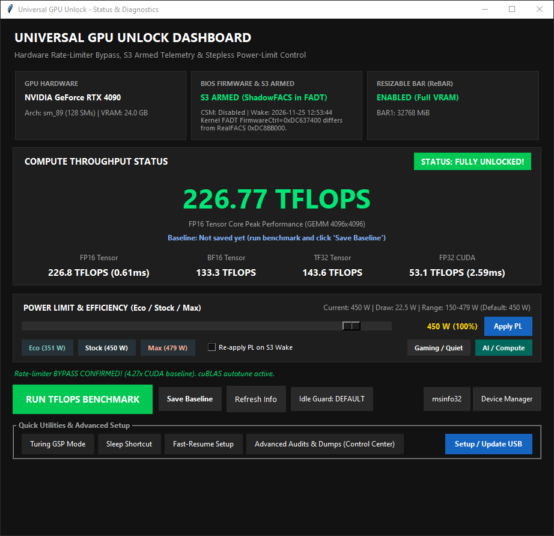
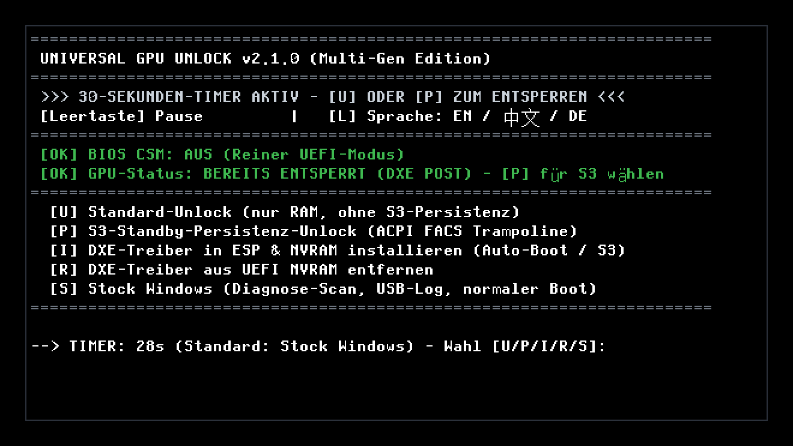

<div align="center">

# Universal GPU Unlock

[English](../README.md) | [简体中文](README.zh-CN.md) | **Deutsch**

Pre-Boot-UEFI-Tensor-Core-Unlocker für NVIDIA RTX 40 (Ada), RTX 30 (Ampere) & RTX 20 (Turing) GPUs.

[](https://github.com/BrightRaider/universal-gpu-unlock/releases/latest)
[](https://github.com/BrightRaider/universal-gpu-unlock/releases/tag/v2.1.0)
[](https://github.com/BrightRaider/universal-gpu-unlock/releases)
[](https://github.com/BrightRaider/universal-gpu-unlock)
[](#sicherheit--anti-cheat)
[](https://ko-fi.com/brightraider)

<p>
  Persistenter ACPI S3 Sleep · Stickloser Auto-Boot · Secure Boot &amp; Vanguard getestet · PyTorch, CUDA &amp; WSL2
</p>



</div>

---

Ich habe Universal GPU Unlock als PC-Gamer gebaut, der auf demselben Alltagsrechner auch lokale KI-Workloads ausführt. NVIDIA drosselt den FP16/BF16-Matrixdurchsatz der Tensor Cores in der Firmware regulärer GeForce-Karten. Mein Ziel ab `v2.0.0` war es, die typischen Alltags-Hürden zu lösen, wegen denen ich frühere Unlocker nie dauerhaft aktiviert gelassen habe: stickloser Kaltstart (`[I]`), Überleben von Windows ACPI S3 Sleep (`[P]` / `[I]`) sowie Secure Boot und Riot Vanguard ohne VBIOS-Flash (`0` permanente Schreibzugriffe, `0 %` Unterschied beim Gaming).

## Schnellstart

1. **Vorbereiten (`Setup.bat`):** **[Universal_GPU_Unlock_v2.1.0.zip](https://github.com/BrightRaider/universal-gpu-unlock/releases/latest)** herunterladen und entpacken, einen FAT32-USB-Stick einstecken und `Setup.bat` starten:
   - `[1]` **USB-Stick neu einrichten** *(inkl. BitLocker-, Secure-Boot- und S0ix-Vorabprüfung)*
   - `[2]` **Vorhandenen USB-Stick aktualisieren**
   - `[3]` **Versteckte `512 MB` `GPU_UNLOCK`-Partition anlegen** *(optional — ermöglicht sticklosen Auto-Boot auch bei `100 MB` kleinen Windows-ESPs)*
   - `[4]` **Dashboard Cockpit öffnen** / `[5]` **Neuestes Boot-Log exportieren** *(kopiert `RUN*.TXT` auch von versteckten `GPU_UNLOCK`- oder geschützten ESP-Partitionen nach `Boot-Logs\`)*
2. **Booten & Entdrosseln:** Vom USB-Stick starten (`F8` / `F11` / `F12`). Das groß skalierte UEFI-Bootmenü prüft vor der Auswahl live den **BIOS-CSM-Status** (`[OK] BIOS CSM: AUS` bzw. Warnung), unterstützt **`[L]`** zum Umschalten der Sprache (`EN` / `简体中文` / `DE`, vorab aus Windows synchronisiert) und **`[Space]`** zum Pausieren des 30s-Countdowns:
   - `[U]` **Standard-Unlock:** Flüchtiger RAM-Unlock nur für die aktuelle Sitzung (nach vollständigem Ausschalten wieder im Werkszustand).
   - `[P]` **S3-Persistenz:** Hält den Unlock über den Windows-Standby (klassisches ACPI S3) hinweg aktiv.
   - `[I]` **Stickloser Auto-Unlock (`NVRAM`):** Installiert `AdaUnlockDxe.efi` (`Driver####`), sodass Windows bei Kaltstarts automatisch entsperrt und ACPI S3 Sleep überlebt — ganz ohne USB-Stick.
   - `[R]` **DXE-Treiber entfernen:** Entfernt `[I]` sauber aus dem UEFI NVRAM und den internen Partitionen.
   - `[S]` **Stock Windows:** Führt nur einen schreibgeschützten Diagnosescan aus und bootet Windows im Werkszustand.

   <details>
   <summary><b>Vorschau: Vergrößertes UEFI-Bootmenü (<code>[L] EN / 中文 / DE</code> &amp; Live-CSM-Prüfung)</b></summary>
   <br>
   
   </details>
3. **Unter Windows prüfen & optimieren:** **`Launch-Dashboard.bat`** starten (GUI Cockpit mit `EN` / `简体中文` / `DE`-Umschalter: Live-`S3 ARMED`-Anzeige, 1-W-Power-Limit-Regler, SM-Clock-Cap (`-lgc`) mit S3-Wake-Re-Apply, Baseline-Vergleich) oder **`Check-GPU-Unlock.bat`** (CLI-Benchmark & `FMLA32/16`-Check).

> [!TIP]
> **BIOS-Checkliste vor dem ersten Start:** Stelle **CSM = Disabled** (Pure UEFI) ein, um schwarze Bildschirme oder Error Code 43 zu vermeiden, und aktiviere **Above 4G Decoding** + **Resizable BAR** für vollen Speicherdurchsatz (+10 % bis +15 %).

---

## Secure Boot & Anti-Cheat

- **Ohne Kernel-Anti-Cheat (am einfachsten):** **Secure Boot** im BIOS vorübergehend auf **Disabled** (bzw. *Other OS*) stellen.
- **Mit aktivem Secure Boot (Windows 11):** Im BIOS unter **Security ➔ Secure Boot ➔ Key Management ➔ Authorized Signatures (`db`)** auf **Append / Enroll DB Key** gehen, die Datei `AdaUnlock_SecureBoot.cer` vom USB-Stick auswählen und mit `F10` speichern. *(Immer **anhängen / append** — niemals vorhandene Microsoft-/OEM-Werksschlüssel löschen.)*

### Riot Vanguard (*Valorant* / *League of Legends*)

1. **Secure Boot aktiviert lassen** mit unangetasteten Werksschlüsseln *(nur falls das BIOS den unsignierten Boot/Treiber blockiert, `AdaUnlock_SecureBoot.cer` an `db` anhängen)*.
2. **Einmalig `[I]` installieren:** Einmal vom USB-Stick booten (`F8` / `F11` / `F12`) und **`[I]`** drücken. *(Ist die Windows-ESP nur `100 MB` groß, vorher `Setup.bat [3]` für die versteckte `512 MB` `GPU_UNLOCK`-Partition ausführen.)*
3. **Windows normal starten:** USB-Stick abziehen und über den **Windows Boot Manager** (`bootmgfw.efi`) starten — niemals über das USB-Bootmenü.

<details>
<summary><b>Verifizierte Vanguard- &amp; S3-Hinweise</b></summary>

- **S3 Sleep + Vanguard:** Getestet mit **aktivem Secure Boot** (`Confirm-SecureBootUEFI: True`) und aktivem `vgk` / `vgtray` / Riot Client sowohl nach sticklosen Neustarts (**224.52 TFLOPS**) als auch nach ACPI S3 Sleep/Wake (**221.19 TFLOPS**; setzt klassisches **ACPI S3** im BIOS voraus, nicht Modern Standby `S0ix`).
- **Hinweis zu Schnellstart (Fast Startup):** Falls nach einem harten Stromausfall Windows Fast Startup `0xC00000D4` auslöst und `vgk.sys` einmal stoppt, reicht ein normaler Windows-**Neustart** (umgeht `hiberfil.sys`).
- **Technische Tiefe:** [OPERATIONS_AND_PERSISTENCE.md](OPERATIONS_AND_PERSISTENCE.md) · [DOCUMENTATION.md](../DOCUMENTATION.md)

</details>

---

## Unterstützte Hardware

| Generation | Architektur | Unterstützte Grafikkarten | Device-IDs |
| :--- | :--- | :--- | :--- |
| **RTX 40 Serie** | **Ada Lovelace** | RTX 4090 / 4090D, RTX 4080 / SUPER, RTX 4070 Ti SUPER / Ti / SUPER / 4070, RTX 4060 Ti (8GB/16GB) / 4060, RTX 4090 / 4080 / 4070 / 4060 Laptop | `0x2684`, `0x2685`, `0x2702`, `0x2703`, `0x2704`, `0x2705`, `0x2717`, `0x2757`, `0x2782`, `0x2783`, `0x2786`, `0x27a0`, `0x27e0`, `0x2803`, `0x2805`, `0x2807`, `0x2820`, `0x2860`, `0x2882`, `0x28a0`, `0x28e0` |
| **RTX 30 Serie** | **Ampere** | RTX 3090, RTX 3090 Ti, RTX 3080 Ti, RTX 3080 (10/12GB), RTX 3070 Ti, RTX 3070, RTX 3060 Ti, RTX 3060, RTX 3050 (8GB/Laptop), RTX 2050 Mobile, CMP 90HX | `0x2204`, `0x2208`, `0x2206`, `0x220a`, `0x2216`, `0x2207`, `0x2482`, `0x2484`, `0x2487`, `0x2488`, `0x2489`, `0x2503`, `0x2504`, `0x2507`, `0x2508`, `0x2520`, `0x2560`, `0x2582`, `0x25ec`, `0x25ed` |
| **RTX 20 Serie** | **Turing** (`TU102` / `TU104` / `TU106`, [#15](https://github.com/BrightRaider/universal-gpu-unlock/issues/15), [#18](https://github.com/BrightRaider/universal-gpu-unlock/issues/18)) | RTX 2080 Ti, TITAN RTX, RTX 2080 / SUPER, RTX 2070 / SUPER, RTX 2060 / SUPER, CMP 50HX, CMP 40HX, Quadro RTX | `0x1E04`, `0x1E07`, `0x1E02`, `0x1E81`, `0x1E82`, `0x1E87`, `0x1E84`, `0x1E89`, `0x1F02`, `0x1F07`, `0x1F06`, `0x1F0B`, `0x1F47`, `0x1F03`, `0x1F08`, `0x1F12`, `0x1E09`, `0x1EB0`, `0x1EB1`, `0x1E30`, `0x1E35` |

- **Plattformen & Multi-GPU:** Läuft mit Founders Edition und Custom-Karten auf Intel (`Z390`–`Z890`) & AMD (`AM4`/`AM5`), Multi-Drive-/VeraCrypt-UEFI-Systemen sowie **Multi-GPU / Headless Compute** (Bild über iGPU, dedizierte GPU nur für Compute).
- **Hardware-Grenzen (`GTX 16xx` / USB4-eGPUs / Laptops):**
  - **GTX 16 Serie (`TU116` / `TU117`) bleibt bewusst ausgeschlossen:** Diese Karten haben keine Tensor Cores, und selbst nach erfolgreichen UEFI-Writes bricht der Windows-Treiber (`nvlddmkm`) in `RmInitAdapter` mit **Error Code 43** ab.
  - **USB4- / Thunderbolt-eGPUs (z. B. `ASM2464PD`):** Für interne PCIe-Slots entwickelt. Getunnelte USB4/Thunderbolt-eGPUs sind experimentell bzw. außerhalb des Supports (Risiko von Boot-Hängern vor `ExitBootServices` durch ACPI-`_PR0`/D3Cold-Ketten sowie Tunnel-Resets durch den OS-Connection-Manager wie `Usb4DeviceRouter` / Linux `thunderbolt`).
  - **Laptop Hybrid / Optimus vs. dGPU-Direct:** Auf Notebooks (`RTX 4090`–`4060` Laptop) hält **dGPU-Direct (MUX)** den Unlock am zuverlässigsten; im Hybrid-/Optimus-Modus kann Windows Runtime D3 (`D3cold`) die GPU im Leerlauf zurücksetzen (dafür `tools\Setup-FastResume.bat` mit `RMDisableRtd3` / ASPM-Schutz ausführen).
- **ESP-Platzbedarf für `[I]`:** **Turing** benötigt ~28 MB (passt auf `100 MB` Standard-ESPs). **Ada & Ampere** benötigen ~85 MB — einfach `Setup.bat [3]` für eine versteckte `512 MB` `GPU_UNLOCK`-Partition nutzen, den USB-Stick als Datenspeicher stecken lassen (`bootmgfw.efi` bootet weiter von der SSD) oder `[P]` S3 Sleep verwenden.
- **Turing GSP-Modus (`RTX 20` / `CMP 40HX`):** Nach dem Unlock einmalig `tools\Toggle-Turing-GSP.bat` als Administrator unter Windows ausführen ([#15](https://github.com/BrightRaider/universal-gpu-unlock/issues/15), [#18](https://github.com/BrightRaider/universal-gpu-unlock/issues/18)).
- **Boot-Loop-Schutz:** Legt vor Hardware-Schreibzugriffen `ATTEMPT.FLG` an und startet nach jedem abgebrochenen Bootvorgang automatisch im sicheren Stock-Modus.

<details>
<summary><b>Community-verifizierte Hardware &amp; Benchmarks</b></summary>
<br>

| Verifizierte GPU | Architektur & Chip | Mainboard & Plattform | Gemessener Durchsatz | Issue / Quelle |
| :--- | :--- | :--- | :--- | :--- |
| **NVIDIA GeForce RTX 2080 Ti 11GB** | Turing (TU102) | Intel Z390 / AMD AM4 | **105.4 TFLOPS** (GSP Compute Mode) | [#15](https://github.com/BrightRaider/universal-gpu-unlock/issues/15) |
| **NVIDIA CMP 40HX 8GB** | Turing (TU106) | AMD AM4 / Intel Plattform | **54.2 TFLOPS** (Headless Compute) | [#18](https://github.com/BrightRaider/universal-gpu-unlock/issues/18) |
| **NVIDIA GeForce RTX 2060 6GB (TU104-150)** | Turing (TU104) | ASUS TUF B450-PLUS GAMING (AM4) | **25.82 TFLOPS** (Dense GEMM, 4.21x über FP32) | [@resYuto in #20](https://github.com/BrightRaider/universal-gpu-unlock/issues/20) |
| **Palit GeForce RTX 3060 12GB** | Ampere (GA106 LHR) | MSI MPG Z390 GAMING PLUS | **46.08 TFLOPS** (~45 % schneller in ComfyUI) | [#11](https://github.com/BrightRaider/universal-gpu-unlock/issues/11) |
| **Gigabyte GeForce RTX 3060 12GB (`10DE:2504`)** | Ampere (GA106) | Gigabyte B760M D2H (ReBAR 16GB) | **47.0 TFLOPS** (`24.2 -> 47.0`, +94.2 %, USB & Stickless `[I]`) | [@henry-richard7 in #24](https://github.com/BrightRaider/universal-gpu-unlock/issues/24) |
| **NVIDIA GeForce RTX 3060 Ti 8GB (`10DE:2489`)** | Ampere (GA104) | MSI PRO Z790-A WIFI DDR4 (i5-14600KF) | **61.23 TFLOPS FP16 (+104.4 %) / 61.97 TFLOPS BF16** | [@karadeveci in #22](https://github.com/BrightRaider/universal-gpu-unlock/issues/22) |
| **NVIDIA GeForce RTX 3060 Ti 8GB (`10DE:2489`)** | Ampere (GA104) | VeraCrypt `1.25.9` UEFI + Dual-GPU (`GTX 1660 SUPER` Anzeige, `ReBAR 8GB`, `S3`) | **60.95–61.23 TFLOPS FP16 / 69.34 TFLOPS BF16** (`S3 ARMED` verifiziert) | [@V85Sf in #23](https://github.com/BrightRaider/universal-gpu-unlock/issues/23) |
| **Gainward GeForce RTX 3080 Phoenix 10GB** | Ampere (GA102) | ASRock A520M-HVS (AM4) | **106.05 TFLOPS** (+95.7 %) | [#17](https://github.com/BrightRaider/universal-gpu-unlock/issues/17) |
| **EVGA GeForce RTX 3080 Ti 12GB** | Ampere (GA102) | ASUS PRIME Z690-A | **127.61 TFLOPS** | [#16](https://github.com/BrightRaider/universal-gpu-unlock/issues/16) |
| **EVGA GeForce RTX 3080 Ti 12GB** | Ampere (GA102) | MSI X570-A PRO | **119.0 TFLOPS** (+84.5 %) | [#12](https://github.com/BrightRaider/universal-gpu-unlock/issues/12) |
| **NVIDIA GeForce RTX 3090 24GB** | Ampere (GA102) | Gigabyte TRX40 AORUS MASTER (3960X) | **117.24 TFLOPS** | [#13](https://github.com/BrightRaider/universal-gpu-unlock/issues/13) |
| **MSI GeForce RTX 3090 GAMING X TRIO 24G** | Ampere (GA102) | ASUS ROG STRIX B550-E GAMING | **105.10 TFLOPS** | Community-verifiziert |
| **EVGA GeForce RTX 3090 Ti 24GB** | Ampere (GA102-350) | ASUS PRIME Z490-P (i7-10700) | **132.4 TFLOPS FP16 / 136.6 TFLOPS BF16** (+102 %) | [@m4ttfx in #495](https://github.com/windows-GPU-UNLOCK/Windows-GPU-UNLOCK/issues/495#issuecomment-7077703728) |
| **Dual-GPU: HP OEM RTX 3090 + EVGA RTX 3060** | Ampere (GA102 + GA106) | ASUS TUF GAMING Z590-PLUS WIFI | **86.0 TFLOPS (3090) / 49.6 TFLOPS (3060)** | [#19](https://github.com/BrightRaider/universal-gpu-unlock/issues/19) |
| **ZOTAC GeForce RTX 4080 Trinity OC** | Ada Lovelace (AD103) | GIGABYTE X870 AORUS ELITE WIFI7 (9800X3D) | **174.29 TFLOPS** | [#9](https://github.com/BrightRaider/universal-gpu-unlock/issues/9) |
| **PNY GeForce RTX 4090 24GB** | Ada Lovelace (AD102) | Gigabyte Z690 UD AC-Y1 (i9-13900K) | **255.0 TFLOPS** (+59.4 %, +15–25 % ComfyUI) | [@jacyzheng in #444](https://github.com/windows-GPU-UNLOCK/Windows-GPU-UNLOCK/issues/444) |
| **NVIDIA GeForce RTX 4090** | Ada Lovelace (AD102) | MSI MPG X670E Carbon WIFI (7800X3D iGPU) | **255.0 TFLOPS** (+54.5 %, Headless & S3 verifiziert) | [@Lizardon1024 in #14](https://github.com/BrightRaider/universal-gpu-unlock/issues/14) · [#25](https://github.com/BrightRaider/universal-gpu-unlock/issues/25) |
| **NVIDIA GeForce RTX 4090** | Ada Lovelace (AD102) | Intel Z790 (Multi-Drive ESP) | **255.4 TFLOPS** | [#8](https://github.com/BrightRaider/universal-gpu-unlock/issues/8) |
| **NVIDIA GeForce RTX 4090** | Ada Lovelace (AD102) | Intel Z690 (Hybrid iGPU / Multi-Display) | **214.0+ TFLOPS** | [#5](https://github.com/BrightRaider/universal-gpu-unlock/issues/5) |
| **ASUS WS C621E SAGE Workstation** | Multi-Socket-Server | ASPEED AST2500 BMC / IPMI | Multi-Console-Isolation verifiziert | [#2](https://github.com/BrightRaider/universal-gpu-unlock/issues/2) |

> [!TIP]
> Alle Messwerte wurden direkt über **`Check-GPU-Unlock.bat`** unter Windows erfasst. Ergebnisse auf weiteren Mainboards, Laptops oder Multi-GPU-Systemen sind in Discussions oder Issues jederzeit willkommen.

</details>

---

## Performance-Benchmarks (RTX 4090)

Der Unlock hebt die künstliche Firmware-Drosselung der **Tensor Cores (GEMM-Matrix-Einheiten)** auf. Reguläre FP32-Shader und die Speicherbandbreite bleiben unverändert auf Werksniveau:

| Workload / Format | Werkszustand | UEFI-Unlock | Gemessener Effekt |
| :--- | :--- | :--- | :--- |
| **FLUX.1-dev Sampling** | 1.20 it/s (25.0s) | **1.97 it/s (15.2s)** | **+64.2 % schneller** |
| **MiniMax-H3 Video DiT** | 15.20 s/it (304s) | **11.15 s/it (223s)** | **+36.3 % schneller** |
| **FP16 Tensor GEMM ($4096^2$)** | 132.1 TFLOPS | **208.9 TFLOPS** | **+58.1 %** *(L2-Cache-limitiert)* |
| **BF16 Tensor GEMM ($8192^2$)** | 149.3 TFLOPS | **167.4 TFLOPS** | **+12.1 %** |
| **FP32 CUDA-Shader** | 51.3 TFLOPS | **48.7 TFLOPS** | **Werkszustand** *(kein Einfluss auf Spiele)* |
| **VRAM-Kopierbandbreite** | 733.4 GB/s | **707.2 GB/s** | **Werkszustand** |

> [!NOTE]
> **`cuBLASLt`-Heuristiken:** NVIDIAs `cuBLASLt` wählt Matrix-Kernel standardmäßig anhand von Heuristiken für gedrosselte Consumer-Karten aus. Mit `torch.backends.cudnn.benchmark = True` in PyTorch (oder aktiviertem Autotuning in ComfyUI) steigen dichte GEMM-, SDXL- und LLM-Prefill-Durchsätze oft um weitere **+15 % bis +35 %**.

### Ada-Effizienz-Sweetspot: Taktdeckel (`-lgc`) schlägt Power-Limit (`-pl`)

Durchgängige `10.1s`-Video-Renders (`242` Frames, `1184×896`) in **MiniMax-H3** auf einer entdrosselten **RTX 4090 (`+600 MHz` VRAM)** zeigen, warum Ada-Workstation-Karten wie die RTX 6000 Ada bei `~300 W` betrieben werden — und warum festes Takt-Capping (`-lgc`) besser abschneidet als `-pl`-Drosselung:

| Tuning-Profil *(Admin-CLI)* | Render-Zeit | Ø Leistung | Energie / Video | Fazit |
| :--- | :--- | :--- | :--- | :--- |
| **`450 W` Stock (`-pl 450`)** | `6m 24s` (`384.4s`) | `411.4 W` | `43.93 Wh` | Maximales Tempo; über `2445 MHz` nur `+3.1 %` schneller bei `+40–60 W` Mehrverbrauch |
| **`315 W` Limit (`-pl 315` / `70 %`)** | `7m 42s` (`462.5s`) | `307.0 W` | `39.44 Wh` | `SW Power Cap` lässt SM-Takt stark schwanken (`~2108 MHz` Ø, `20.3 %` langsamer) |
| **`-lgc 210,2450` *(offenes `450 W`-PL)*** | **`6m 36s`** (`396.4s`) | `370.8 W` | **`40.89 Wh`** (`-6.9 %`) | **Sweetspot:** **66s schneller** als `70 % PL`, innerhalb `3.1 %` von `450 W` |
| **`-lgc 210,2300` *(offenes `450 W`-PL)*** | **`7m 08s`** (`427.9s`) | `325.6 W` | **`38.74 Wh`** (`-11.8 %`) | **Max Efficiency:** **34.6s schneller & weniger Wh** als `70 % PL` |

- **Praxistipp:** Im Cockpit **`Launch-Dashboard.bat`** einfach **Sweetspot** / **Max Eff** oder das Profil **AI Efficiency** wählen (bzw. `nvidia-smi -lgc 210,2450` / `210,2300`), zusammen mit `+600–700 MHz` VRAM (`+3.5–4.5 %` im CUDA-`P2`-State; `+800/+900 MHz` bringt durch GDDR6X-Timing/ECC keinen Vorteil mehr). Vor dem Gaming einfach auf **Gaming / Stock** (`-rgc`) klicken. *(Die genannten MHz-Ziele gelten für RTX 40 Ada; RTX 30/20 skalieren automatisch auf unterstützte Taktschritte. Alle Messreihen stehen in [DOCUMENTATION.md](../DOCUMENTATION.md#1353-ada-rtx-4090-efficiency-sweetspot--clock-capping-vs-power-limiting).)*

---

## Sicherheit & Anti-Cheat

- **Flüchtig (nur im RAM):** Der Unlock liegt ausschließlich in GPU-Registern und verschwindet nach einem Kalt-Aus restlos (`0` VBIOS-Schreibzugriffe).
- **Unmodifizierte NVIDIA-Treiber:** Funktioniert mit regulären Game Ready und Studio Treibern (`nvlddmkm.sys`).
- **Anti-Cheat:** Keine Treiber-Patches, keine Kernel-Hooks und keine Speicher-Injektion (`UEFISecureBootEnabled` bleibt `1`). **Riot Vanguard (*Valorant* / *League of Legends*)** läuft mit **aktiviertem Secure Boot** über `[I]` (`AdaUnlockDxe.efi`) und regulären **Windows Boot Manager**-Start (siehe [Secure Boot & Anti-Cheat](#secure-boot--anti-cheat)). Easy Anti-Cheat, BattlEye und Ricochet wurden nicht systematisch getestet.
- **Last- & S3-bewusste Prüfung:** `Check-GPU-Unlock.bat` und `Launch-Dashboard.bat` prüfen GPU-Auslastung (`nvidia-smi` > 15 %) und `FMLA32/FMLA16`-Verhältnisse vor dem Benchmark, damit aktive Hintergrundprogramme keine falschen Stock-Warnungen auslösen.
- **Standby- & Ruhezustand-Helfer:** Enthält `tools\Setup-FastResume.bat` (Ruhezustand-Verknüpfung + Idle-Relock-Schutz `RMDisableRtd3` / PCIe ASPM aus für Optimus & Headless-GPUs) und `tools\Toggle-Sleep-Button.bat` (Startmenü-Standby bei `[U]` verbergen).

> [!WARNING]
> **Windows S4 Ruhezustand vs. Pre-Boot-ReBAR-Mods:** Universal GPU Unlock setzt einen reinen SS-Register-Unlock um, ohne Pre-Boot-ReBAR-BAR1-Register (`0x610`/`0xBC0`) anzufassen — daher bleibt S4 Hibernate sicher. Kombiniere **niemals** externe Pre-Boot-ReBAR-Overrides (`ReBarDxe` / `0x610`/`0xBC0`) mit Windows S4 Hibernate (`Setup-FastResume.bat` / `shutdown /h`), da dies `Kernel-Power 41`-Hänger auslöst (erzwungene GOP-Reconnects beim S4-Resume führen zudem zu TDR-Neustarts).
- **Technischer Leitfaden:** Vollständige Details zu Telemetrie, UEFI-Schutz und S3-Trampolin stehen in **[OPERATIONS_AND_PERSISTENCE.md](OPERATIONS_AND_PERSISTENCE.md)**.

---

<details>
<summary><b>Technische Architektur &amp; Workload-Skalierung</b></summary>

### Warum ist der Gewinn bei $4096 \times 4096$ (+58.1 %) am größten?
Ada Lovelace AD102 besitzt einen **72 MB großen L2-Cache**. Eine $4096 \times 4096$ FP16-Matrix (~32 MB pro Operand) passt komplett in den L2-Cache (>3.5 TB/s interne Bandbreite), sodass die Ausführung rein **compute-limitiert** abläuft. Bei $16384 \times 16384$ (>1.5 GB) bremst der externe GDDR6X-Speicherbus (**memory-bandwidth bound**). Moderne KI-Modelle zerteilen Matrizen in $1024$–$4096$-Kacheln und landen genau im optimalen Bereich.

### Warum profitiert quantisierter `Q4`-LLM-Token-Decode kaum (~0–5 %)?
Einzel-Stream-Token-Generierung bei quantisierten LLMs (**`Q4` / `Q4_K_M` / `MoE` Decode**) — ebenso wie speicherlimitierte Videofilter (z. B. Topaz Video AI in `#22`) — hängt fast vollständig an der **VRAM-Speicherbandbreite**, die unverändert bleibt (`0 %`). Rechenintensive **BF16/FP16-Trainingsläufe**, **ComfyUI / FLUX / Video-DiT** sowie **langer LLM-Prefill** lasten die Tensor Cores direkt aus und profitieren voll.

</details>

---

## Build & Tests

Benötigt Visual Studio 2022 C++ Build Tools (x64).

| Befehl | Funktion |
| :--- | :--- |
| `src\Build-Experimental-MSVC.ps1` | Baut `BOOTX64.EFI` und **überschreibt `bin\BOOTX64.EFI`** (signiert nur bei installiertem Maintainer-Zertifikat). |
| `src\Build-Dxe-Driver.ps1` | Baut `AdaUnlockDxe.efi` und **überschreibt `bin\AdaUnlockDxe.efi`** (gleiche Signierregel). |
| `src\Build-Gpu-Topology-Diagnostic.ps1` | Baut die schreibgeschützte PCIe-Topologie-Diagnose-EFI. |
| `tests\Run-MsvcHostTests.ps1` | Führt alle 12 MSVC-Host-Testsuiten aus (`driver_nvram`, `dxe_main`, `boot_select`, `csm_handover`, `gpu_inventory`, `gpu_topology`, `gpu_discovery`, `turing_local`, `s3_resume`, `multi_gpu_second_preflight`, `already_unlocked`, `s3_non_identity`). |
| `python -m unittest tests.test_clock_cap -v` | Testet `-lgc`-Takt-Parsing, Ada/Ampere-Presets, Laptop-Profile, S3-Wake-Re-Apply, PLM-Log-Decoding und dreisprachiges Dashboard-i18n. |

Die gcc/clang-Hosttests liegen unter `tests/`. GitHub Actions (`.github/workflows/gpu-topology-diagnostic.yml`) prüft automatisch jeden Push und Pull Request auf `src/` oder `tests/`. Alle Tests mocken UEFI-Protokolle und `nvidia-smi`; kein Test greift direkt auf Live-GPUs zu.

---

## Changelog

Vollständige Versionshistorie und neue GPU-IDs stehen in **[CHANGELOG.md](../CHANGELOG.md)** *(bzw. unter [GitHub Releases](https://github.com/BrightRaider/universal-gpu-unlock/releases))*.

---

## Projektstruktur

```text
├── bin/                         <- Signierte BOOTX64.EFI, AdaUnlockDxe.efi & begleitende Doku
├── assets/
│   ├── AD102-ASSETS/            <- Ada Lovelace Firmware-Payloads (RTX 40 Serie)
│   ├── GA102-ASSETS/            <- Ampere Firmware-Payloads (RTX 30 Serie)
│   └── TU102-ASSETS/            <- Turing Staging-Payloads (RTX 20 / CMP Serie)
├── src/                         <- C-/Assembler-Quellcode, MSVC-Buildskripte & Build-Release-Zip.ps1
├── tests/                       <- Host-Tests mit gemocktem UEFI & Python-Unit-Tests
├── docs/                        <- Übersetzungen (README.zh-CN.md, README.de.md), Whitepaper, Archiv & images/
├── Setup.bat                    <- Einheitlicher Launcher (1: USB, 2: Update, 3: Hidden Partition, 4: Dashboard, 5: Log)
├── Launch-Dashboard.bat         <- Primäres GUI-Cockpit (Benchmarks, S3 Armed, PL / -lgc, Log-Export)
├── Check-GPU-Unlock.bat         <- Eigenständiger CLI-Benchmark & Hardware-Check
├── tools/                       <- PowerShell- & Python-Setup-/Diagnose-Helfer
├── AdaUnlock_SecureBoot.cer     <- Authenticode-Zertifikat für Secure-Boot-db-Import
├── DOCUMENTATION.md             <- Vollständige englische technische Dokumentation
└── CHANGELOG.md                 <- Aktuelle Änderungshistorie (ältere Einträge in docs/CHANGELOG_ARCHIVE.md)
```

---

## Danksagung

* **[geodnb](https://github.com/geodnb) / [Ablation Lab](https://github.com/Ablation-Lab):** Pionierforschung zu GPU-Cold-States und Registerarchitektur als Basis für diesen Windows-Port ([Ablation Lab auf GitHub](https://github.com/Ablation-Lab) · [YouTube @AblationLab](https://www.youtube.com/@AblationLab)).
* **Zagitta & WildFlash1st:** Vorarbeit bei Linux `gpu-unlock` und `cmp90hx-unlock`.
* **[Ahsan Umair (@ahsanumair)](https://github.com/ahsanumair):** Frühes Windows-WPF-Layout als Basis für den Diagnose-Begleiter `tools/Universal-Control-Center.cmd`.
* **TOTORONG & JustAResearcher:** Frühe Windows-UEFI-Proof-of-Concepts.
* **Igor Wallossek (Igor'sLAB):** Technische Analysen, Leistungsverifikation und Community-Austausch.

---

## Unterstützung

Wenn dir Universal GPU Unlock Renderzeit gespart oder deine KI-Workflows beschleunigt hat, freue ich mich über einen Kaffee zur Unterstützung weiterer Tests und Updates:

<a href='https://ko-fi.com/brightraider' target='_blank'></a>
