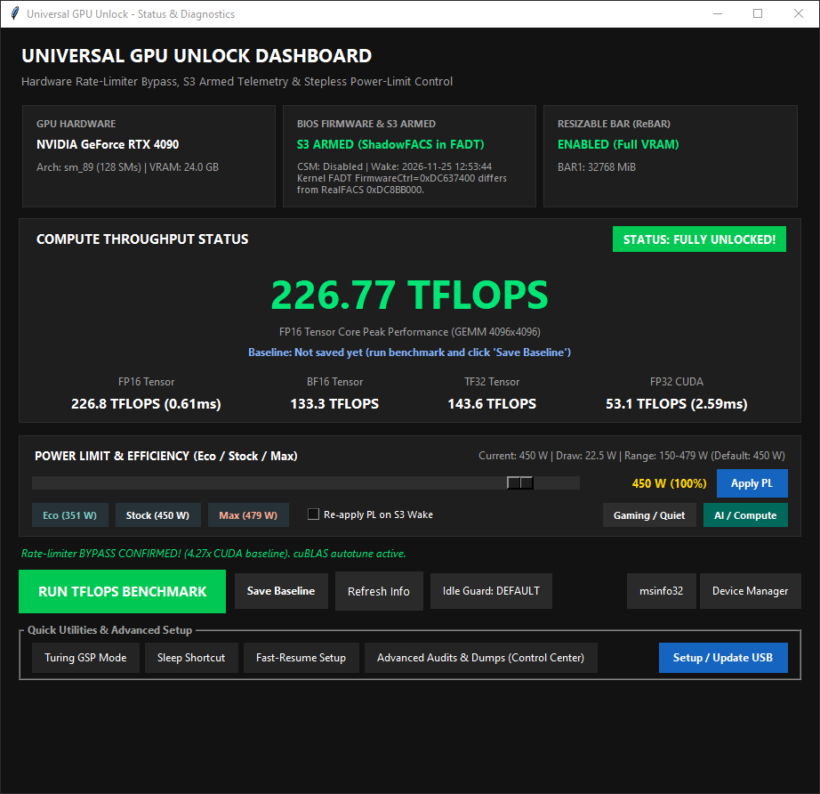

<div align="center">

# Universal GPU Unlock

[English](../README.md) | **简体中文** | [Deutsch](README.de.md)

面向 NVIDIA RTX 40 (Ada)、RTX 30 (Ampere) 与 RTX 20 (Turing) 显卡的 UEFI 预引导 Tensor Core 解锁工具。

[](https://github.com/BrightRaider/universal-gpu-unlock/releases/latest)
[](https://github.com/BrightRaider/universal-gpu-unlock/releases/tag/v2.0.0)
[](https://github.com/BrightRaider/universal-gpu-unlock/releases)
[](https://github.com/BrightRaider/universal-gpu-unlock)
[](#安全模式与反作弊)
[](https://ko-fi.com/brightraider)

<p>
  支持 ACPI S3 睡眠保持 · 免 U 盘自动解锁 · 支持 Secure Boot 与 Vanguard · 适配 PyTorch、CUDA 与 WSL2
</p>



</div>

---

我是一名 PC 玩家，同时也在同一台主力机上跑本地 AI 任务。NVIDIA 在消费级 GeForce 固件中限制了 FP16/BF16 Tensor Core 矩阵计算速率。早期已有各种 UEFI 预引导解锁方案，而我在 `v2.0.0` 中重点解决了让我无法把它留在主力游戏机上日常使用的几个痛点：免 U 盘冷启动自动解锁（`[I]`）、Windows ACPI S3 睡眠唤醒保持（`[P]` / `[I]`）、以及在不刷写 VBIOS 的前提下兼容 Secure Boot 与 Riot Vanguard（零永久写入、游戏性能 `0%` 变化）。

## 快速开始

1. **制作启动环境（`Setup.bat`）：** 下载并解压 **[Universal_GPU_Unlock_v2.0.0.zip](https://github.com/BrightRaider/universal-gpu-unlock/releases/latest)**，插入一个 FAT32 格式的 U 盘，然后运行 `Setup.bat`：
   - `[1]` **全新制作启动 U 盘** *（自动检查 BitLocker / Secure Boot / 现代待机 S0ix）*
   - `[2]` **更新现有启动 U 盘**
   - `[3]` **创建隐藏的 `512 MB` `GPU_UNLOCK` 分区** *（可选——当 Windows 默认 ESP 只有 `100 MB` 时，用于实现免 U 盘启动）*
   - `[4]` **打开控制面板（Dashboard）** / `[5]` **导出最新启动日志** *（可从隐藏 `GPU_UNLOCK` 或受保护 ESP 中将 `RUN*.TXT` 复制到 `Boot-Logs\`）*
2. **开机引导与解锁：** 重启从 U 盘引导（`F8` / `F11` / `F12`），按对应按键即可 *（按 `[Space]` 空格键可随时暂停 30 秒倒计时）*：
   - `[U]` **标准解锁（仅限当前会话）：** 仅写入易失性内存与寄存器，完全断电关机后自动恢复原厂状态。
   - `[P]` **S3 睡眠保持解锁：** 支持 Windows 传统 ACPI S3 睡眠/待机唤醒后继续保持解锁。
   - `[I]` **免 U 盘自动解锁（写入 `NVRAM`）：** 安装 `AdaUnlockDxe.efi`（`Driver####`）。之后每次冷启动自动解锁并支持 S3 睡眠保持，无需再插着 U 盘。
   - `[R]` **卸载 DXE 驱动：** 从 UEFI NVRAM 和内置分区中干净移除 `[I]`。
   - `[S]` **原厂模式启动 Windows：** 仅作只读硬件扫描和日志记录，跳过解锁直接进入 Windows。
3. **在 Windows 中验证与调优：** 运行 **`Launch-Dashboard.bat`**（支持右上角 `EN` / `简体中文` / `DE` 切换的图形控制面板：实时 `S3 ARMED` 指示、1 W 步进功耗上限滑块、`-lgc` 核心锁频控制与 S3 唤醒重设、基准对比）或 **`Check-GPU-Unlock.bat`**（命令行跑分与 `FMLA32/16` 检测）。

> [!TIP]
> **首次启动 BIOS 检查项：** 请在 BIOS 中将 **CSM 设为 Disabled**（纯 UEFI 模式），以免黑屏或报 Error Code 43；同时开启 **Above 4G Decoding** 和 **Resizable BAR** 以获得完整的显存带宽（+10% 至 +15%）。

---

## 安全启动与反作弊

- **不玩带内核反作弊的游戏（最简单）：** 在 BIOS 中临时关闭 **Secure Boot**（设为 Disabled 或 Other OS）。
- **保持开启 Secure Boot（Windows 11）：** 进入 BIOS 的 **Security ➔ Secure Boot ➔ Key Management ➔ Authorized Signatures (`db`)**，选择 **Append / Enroll DB Key（追加密钥）**，选中 U 盘根目录的 `AdaUnlock_SecureBoot.cer` 后保存（`F10`）。*（请务必选择 **Append 追加**，切勿删除微软或主板原厂密钥。）*

### Riot Vanguard（《无畏契约》/《英雄联盟》）

1. **保持 Secure Boot 开启**并保留原厂密钥*（若主板拦截未信任驱动，再将 `AdaUnlock_SecureBoot.cer` 追加到 `db`）*。
2. **安装一次 `[I]`：** 从 U 盘引导一次（`F8` / `F11` / `F12`）并按 **`[I]`**。*（如果系统的 EFI 分区只有 `100 MB`，请先运行 `Setup.bat [3]` 创建隐藏的 `512 MB` `GPU_UNLOCK` 分区来存放 Ada/Ampere 固件。）*
3. **正常启动 Windows：** 拔掉 U 盘，通过 **Windows Boot Manager**（`bootmgfw.efi`）正常进入系统——不要从 U 盘菜单引导。

<details>
<summary><b>Vanguard + 免 U 盘 S3 睡眠实测记录</b></summary>

- **S3 睡眠 + Vanguard：** 在 **Secure Boot 开启**（`Confirm-SecureBootUEFI: True`）且 `vgk` / `vgtray` / Riot Client 正常运行的环境下，免 U 盘重启（**224.52 TFLOPS**）以及 ACPI S3 睡眠唤醒后（**221.19 TFLOPS**）均通过实测（需要主板 BIOS 使用经典 **ACPI S3**，而非现代待机 `S0ix`）。
- **快速启动（Fast Startup）提示：** 若意外断电触发 Windows 快速启动 `0xC00000D4` 导致 `vgk.sys` 暂时停止，执行一次正常的 Windows **重启（Restart）**（跳过 `hiberfil.sys`）即可恢复。
- **技术细节文档：** [OPERATIONS_AND_PERSISTENCE.md](OPERATIONS_AND_PERSISTENCE.md) · [DOCUMENTATION.md](../DOCUMENTATION.md)

</details>

---

## 支持的硬件

| 世代 | 架构 | 支持显卡型号 | PCI 设备 ID |
| :--- | :--- | :--- | :--- |
| **RTX 40 系列** | **Ada Lovelace** | RTX 4090 / 4090D、RTX 4080 / SUPER、RTX 4070 Ti SUPER / Ti / SUPER / 4070、RTX 4060 Ti (8GB/16GB) / 4060、RTX 4090 / 4080 / 4070 / 4060 笔记本电脑 GPU | `0x2684`, `0x2685`, `0x2702`, `0x2703`, `0x2704`, `0x2705`, `0x2717`, `0x2757`, `0x2782`, `0x2783`, `0x2786`, `0x27a0`, `0x27e0`, `0x2803`, `0x2805`, `0x2807`, `0x2820`, `0x2860`, `0x2882`, `0x28a0`, `0x28e0` |
| **RTX 30 系列** | **Ampere** | RTX 3090、RTX 3090 Ti、RTX 3080 Ti、RTX 3080 (10/12GB)、RTX 3070 Ti、RTX 3070、RTX 3060 Ti、RTX 3060、RTX 3050 (8GB/Laptop)、RTX 2050 Mobile、CMP 90HX | `0x2204`, `0x2208`, `0x2206`, `0x220a`, `0x2216`, `0x2207`, `0x2482`, `0x2484`, `0x2487`, `0x2488`, `0x2489`, `0x2503`, `0x2504`, `0x2507`, `0x2508`, `0x2520`, `0x2560`, `0x2582`, `0x25ec`, `0x25ed` |
| **RTX 20 系列** | **Turing** (`TU102` / `TU104` / `TU106`，见 [#15](https://github.com/BrightRaider/universal-gpu-unlock/issues/15)、[#18](https://github.com/BrightRaider/universal-gpu-unlock/issues/18)) | RTX 2080 Ti、TITAN RTX、RTX 2080 / SUPER、RTX 2070 / SUPER、RTX 2060 / SUPER、CMP 50HX、CMP 40HX、Quadro RTX | `0x1E04`, `0x1E07`, `0x1E02`, `0x1E81`, `0x1E82`, `0x1E87`, `0x1E84`, `0x1E89`, `0x1F02`, `0x1F07`, `0x1F06`, `0x1F0B`, `0x1F47`, `0x1F03`, `0x1F08`, `0x1F12`, `0x1E09`, `0x1EB0`, `0x1EB1`, `0x1E30`, `0x1E35` |

- **平台与多卡支持：** 适配 Founders Edition 与各 AIC 非公卡、Intel (`Z390`–`Z890`) 与 AMD (`AM4`/`AM5`) 平台、多硬盘 / VeraCrypt UEFI 系统，以及**无头计算与多 GPU 混插**（集显输出画面，独显纯计算）。
- **明确边界与硬件限制（GTX 16xx / USB4 显卡坞 / 笔记本）：**
  - **刻意排除 GTX 16 系列（`TU116` / `TU117`）：** 该系列没有 Tensor Core，且即便 UEFI 预引导阶段全部写入成功，Windows `nvlddmkm` 驱动仍会在 `RmInitAdapter` 时报错 **Code 43**。
  - **USB4 / 雷电外置显卡坞（如 `ASM2464PD`）：** 本工具面向直连主板 PCIe 插槽的显卡。经过隧道的 USB4/雷电显卡坞不在保证范围内（属于实验性质），存在 `ExitBootServices` 前因平台 ACPI 电源链路（`_PR0`/D3Cold）卡死的风险，以及系统连接管理器（Windows `Usb4DeviceRouter` / Linux `thunderbolt`）重建隧道时重置寄存器的情况。
  - **笔记本混合输出（Optimus）与独显直连（dGPU-Direct）：** 在笔记本 GPU（`RTX 4090`–`4060` Laptop）上，BIOS 开启**独显直连（MUX）**最为稳定；在混合模式下，Windows 空闲运行时 D3（`D3cold`）可能重新下电复位显卡，建议运行 `tools\Setup-FastResume.bat` 启用 `RMDisableRtd3` 与关闭 ASPM 防护。
- **免 U 盘 `[I]` 的 ESP 空间需求：** **Turing** 仅需约 28 MB（可直接放入 `100 MB` 默认 ESP）；**Ada 与 Ampere** 需要约 85 MB，可运行 `Setup.bat [3]` 分出隐藏 `512 MB` `GPU_UNLOCK` 分区、保留 U 盘仅作固件存放（仍从内置 `bootmgfw.efi` 启动 Windows），或使用 `[P]` S3 睡眠模式。
- **Turing GSP 模式（`RTX 20` / `CMP 40HX`）：** 预引导解锁后，请在 Windows 中以管理员身份运行一次 `tools\Toggle-Turing-GSP.bat` 以开启驱动 GSP 模式并释放算力（见 [#15](https://github.com/BrightRaider/universal-gpu-unlock/issues/15)、[#18](https://github.com/BrightRaider/universal-gpu-unlock/issues/18)）。
- **防无限重启保护（Boot-Loop Safeguard）：** 写入硬件寄存器前会生成临时 `ATTEMPT.FLG`；若上次解锁在启动途中异常中断，下次开机会自动跳过解锁并原厂引导进入 Windows。

<details>
<summary><b>社区实测硬件与算力记录</b></summary>
<br>

| 已验证显卡 | 架构与核心 | 主板与平台 | 实测吞吐量 | 验证 Issue |
| :--- | :--- | :--- | :--- | :--- |
| **NVIDIA GeForce RTX 2080 Ti 11GB** | Turing (TU102) | Intel Z390 / AMD AM4 | **105.4 TFLOPS**（GSP 固件计算模式） | [#15](https://github.com/BrightRaider/universal-gpu-unlock/issues/15) |
| **NVIDIA CMP 40HX 8GB** | Turing (TU106) | AMD AM4 / Intel 平台 | **54.2 TFLOPS**（无头计算卡） | [#18](https://github.com/BrightRaider/universal-gpu-unlock/issues/18) |
| **NVIDIA GeForce RTX 2060 6GB (TU104-150)** | Turing (TU104) | ASUS TUF B450-PLUS GAMING (AM4) | **25.82 TFLOPS**（Dense GEMM，FP32 基准的 4.21 倍） | [@resYuto in #20](https://github.com/BrightRaider/universal-gpu-unlock/issues/20) |
| **Palit GeForce RTX 3060 12GB** | Ampere (GA106 LHR) | MSI MPG Z390 GAMING PLUS | **46.08 TFLOPS**（ComfyUI 提速约 45%） | [#11](https://github.com/BrightRaider/universal-gpu-unlock/issues/11) |
| **Gigabyte GeForce RTX 3060 12GB (`10DE:2504`)** | Ampere (GA106) | Gigabyte B760M D2H (ReBAR 16GB) | **47.0 TFLOPS**（`24.2 -> 47.0`，+94.2%，USB 与免 U 盘 `[I]` 均验证） | [@henry-richard7 in #24](https://github.com/BrightRaider/universal-gpu-unlock/issues/24) |
| **NVIDIA GeForce RTX 3060 Ti 8GB (`10DE:2489`)** | Ampere (GA104) | MSI PRO Z790-A WIFI DDR4 (i5-14600KF) | **61.23 TFLOPS FP16 (+104.4%) / 61.97 TFLOPS BF16** | [@karadeveci in #22](https://github.com/BrightRaider/universal-gpu-unlock/issues/22) |
| **Gainward GeForce RTX 3080 Phoenix 10GB** | Ampere (GA102) | ASRock A520M-HVS (AM4) | **106.05 TFLOPS**（+95.7%） | [#17](https://github.com/BrightRaider/universal-gpu-unlock/issues/17) |
| **EVGA GeForce RTX 3080 Ti 12GB** | Ampere (GA102) | ASUS PRIME Z690-A | **127.61 TFLOPS** | [#16](https://github.com/BrightRaider/universal-gpu-unlock/issues/16) |
| **EVGA GeForce RTX 3080 Ti 12GB** | Ampere (GA102) | MSI X570-A PRO | **119.0 TFLOPS**（+84.5%） | [#12](https://github.com/BrightRaider/universal-gpu-unlock/issues/12) |
| **NVIDIA GeForce RTX 3090 24GB** | Ampere (GA102) | Gigabyte TRX40 AORUS MASTER (3960X) | **117.24 TFLOPS** | [#13](https://github.com/BrightRaider/universal-gpu-unlock/issues/13) |
| **MSI GeForce RTX 3090 GAMING X TRIO 24G** | Ampere (GA102) | ASUS ROG STRIX B550-E GAMING | **105.10 TFLOPS** | 社区验证 |
| **EVGA GeForce RTX 3090 Ti 24GB** | Ampere (GA102-350) | ASUS PRIME Z490-P (i7-10700) | **132.4 TFLOPS FP16 / 136.6 TFLOPS BF16**（+102%） | [@m4ttfx in #495](https://github.com/windows-GPU-UNLOCK/Windows-GPU-UNLOCK/issues/495#issuecomment-7077703728) |
| **双卡：HP OEM RTX 3090 + EVGA RTX 3060** | Ampere (GA102 + GA106) | ASUS TUF GAMING Z590-PLUS WIFI | **86.0 TFLOPS (3090) / 49.6 TFLOPS (3060)** | [#19](https://github.com/BrightRaider/universal-gpu-unlock/issues/19) |
| **ZOTAC GeForce RTX 4080 Trinity OC** | Ada Lovelace (AD103) | GIGABYTE X870 AORUS ELITE WIFI7 (9800X3D) | **174.29 TFLOPS** | [#9](https://github.com/BrightRaider/universal-gpu-unlock/issues/9) |
| **PNY GeForce RTX 4090 24GB** | Ada Lovelace (AD102) | Gigabyte Z690 UD AC-Y1 (i9-13900K) | **255.0 TFLOPS**（+59.4%，ComfyUI +15–25%） | [@jacyzheng in #444](https://github.com/windows-GPU-UNLOCK/Windows-GPU-UNLOCK/issues/444) |
| **NVIDIA GeForce RTX 4090** | Ada Lovelace (AD102) | MSI MPG X670E Carbon WIFI (7800X3D iGPU) | **255.0 TFLOPS**（+54.5%，无头计算 & S3 验证通过） | [@Lizardon1024 in #14](https://github.com/BrightRaider/universal-gpu-unlock/issues/14) · [#25](https://github.com/BrightRaider/universal-gpu-unlock/issues/25) |
| **NVIDIA GeForce RTX 4090** | Ada Lovelace (AD102) | Intel Z790（多硬盘 ESP） | **255.4 TFLOPS** | [#8](https://github.com/BrightRaider/universal-gpu-unlock/issues/8) |
| **NVIDIA GeForce RTX 4090** | Ada Lovelace (AD102) | Intel Z690（混合集显与多屏） | **214.0+ TFLOPS** | [#5](https://github.com/BrightRaider/universal-gpu-unlock/issues/5) |
| **ASUS WS C621E SAGE 工作站** | 多路服务器 | ASPEED AST2500 BMC / IPMI | 多控制台隔离验证通过 | [#2](https://github.com/BrightRaider/universal-gpu-unlock/issues/2) |

> [!TIP]
> 以上数据均使用 Windows 下的 **`Check-GPU-Unlock.bat`** 实测获得。如果你在其它主板、笔记本或多卡设备上验证成功，欢迎在 Discussions 或 Issues 中分享结果。

</details>

---

## 性能实测参考（RTX 4090）

本次解锁解除的是固件对 **Tensor Core 矩阵运算（GEMM）** 的发射速率限制；标准 FP32 CUDA 着色器与显存带宽保持原厂状态：

| 工作负载 / 测试项 | 原厂状态 | UEFI 解锁后 | 实测变化 |
| :--- | :--- | :--- | :--- |
| **FLUX.1-dev 生图采样** | 1.20 it/s (25.0s) | **1.97 it/s (15.2s)** | **提速 +64.2%** |
| **MiniMax-H3 视频 DiT** | 15.20 s/it (304s) | **11.15 s/it (223s)** | **提速 +36.3%** |
| **FP16 Tensor GEMM ($4096^2$)** | 132.1 TFLOPS | **208.9 TFLOPS** | **+58.1%** *（L2 缓存受限区）* |
| **BF16 Tensor GEMM ($8192^2$)** | 149.3 TFLOPS | **167.4 TFLOPS** | **+12.1%** |
| **FP32 CUDA 浮点算力** | 51.3 TFLOPS | **48.7 TFLOPS** | **原厂持平** *（不影响游戏）* |
| **VRAM 显存拷贝带宽** | 733.4 GB/s | **707.2 GB/s** | **原厂持平** |

> [!NOTE]
> **`cuBLASLt` 算法启发式选择：** NVIDIA 官方 `cuBLASLt` 库会根据消费卡原厂半速模型来挑算子策略。在 PyTorch 代码中加入 `torch.backends.cudnn.benchmark = True`（或在 ComfyUI 中开启 autotune），可在稠密 GEMM、SDXL 与 LLM Prefill 上再释放 **+15% 至 +35%** 性能。

### Ada 能效甜点区：核心锁频（`-lgc`）优于限功耗墙（`-pl`）

在已解锁的 **RTX 4090（显存 `+600 MHz`）** 上运行连续 `10.1s`（`242` 帧、`1184×896`）**MiniMax-H3** 视频生成的对比，揭示了为何 RTX 6000 Ada 等专业卡标定在 `~300 W`，以及为何锁定 SM 频率比降功耗墙更高效：

| 调优方案 *（管理员 CLI）* | 渲染耗时 | 平均功耗 | 单视频耗电量 | 结论 |
| :--- | :--- | :--- | :--- | :--- |
| **`450 W` 原厂功耗（`-pl 450`）** | `6m 24s` (`384.4s`) | `411.4 W` | `43.93 Wh` | 极限速度；超过 `2445 MHz` 后耗时仅快 `3.1%`，功耗却多出 `40–60 W` |
| **`315 W` 功耗墙（`-pl 315` / `70%`）** | `7m 42s` (`462.5s`) | `307.0 W` | `39.44 Wh` | `SW Power Cap` 导致频率剧烈抖动（均值 `~2108 MHz`，慢 `20.3%`） |
| **`-lgc 210,2450` *（放开 `450 W` PL）*** | **`6m 36s`** (`396.4s`) | `370.8 W` | **`40.89 Wh`** (`-6.9%`) | **速度甜点：** 比 `70% PL` 快 **66 秒**，接近 `450 W` 的 `96.9%` 速度 |
| **`-lgc 210,2300` *（放开 `450 W` PL）*** | **`7m 08s`** (`427.9s`) | `325.6 W` | **`38.74 Wh`** (`-11.8%`) | **能效最优：** 比 `70% PL` 快 **34.6 秒**且总耗电（Wh）**更低** |

- **实用建议：** 直接在 **`Launch-Dashboard.bat`** 中点 **Sweetspot** / **Max Eff** 或 **AI Efficiency** 预设（或执行 `nvidia-smi -lgc 210,2450` / `210,2300`），配合显存 `+600–700 MHz`（在 CUDA `P2` 状态下采样快 `3.5–4.5%`；`+800/+900 MHz` 会因 GDDR6X ECC 纠错与时序反而不升）。玩游戏前点一下 **Gaming / Stock**（`-rgc`）即可恢复完整加速频表。*（上述预设频率针对 RTX 40 Ada；RTX 30/20 会自动按支持频点比例换算。完整扫描数据见 [DOCUMENTATION.md](../DOCUMENTATION.md#1353-ada-rtx-4090-efficiency-sweetspot--clock-capping-vs-power-limiting)。）*

---

## 安全模式与反作弊

- **纯内存/易失性修改：** 仅改变显卡运行期寄存器，完全断电后自动恢复出厂原貌（**零** VBIOS 刷写）。
- **兼容官方原版驱动：** 直接运行于未修改的 NVIDIA Game Ready / Studio 官方驱动（`nvlddmkm.sys`）。
- **反作弊兼容性：** 无驱动补丁、无内核 Hook、无运行时内存注入（`UEFISecureBootEnabled` 保持 `1`）。**Riot Vanguard（《无畏契约》/《英雄联盟》）** 通过 `[I]`（`AdaUnlockDxe.efi`）配合正常 **Windows Boot Manager** 启动已在启用 **Secure Boot** 下验证可用（见 [安全启动与反作弊](#安全启动与反作弊)）。Easy Anti-Cheat、BattlEye 与 Ricochet 尚未做系统性测试。
- **负载与 S3 感知检测：** `Check-GPU-Unlock.bat` 与 `Launch-Dashboard.bat` 会在跑分前读取实时显卡占用（`nvidia-smi` > 15%）与 `FMLA32/FMLA16` 精度比，避免后台程序干扰造成误报。
- **睡眠与休眠辅助工具：** 内置 `tools\Setup-FastResume.bat`（一键休眠快捷方式 + 为 Optimus 与无头显卡禁用空闲 RTD3 / ASPM 的 `RMDisableRtd3`）以及 `tools\Toggle-Sleep-Button.bat`（使用 `[U]` 模式时隐藏开始菜单中的睡眠按钮）。

> [!WARNING]
> **Windows S4 休眠与预引导 ReBAR 修改互斥：** Universal GPU Unlock 仅通过纯 SS 寄存器解锁，不会篡改预引导阶段 ReBAR BAR1 寄存器（`0x610`/`0xBC0`），因此可安全支持 S4 休眠。切勿将第三方预引导 ReBAR 补丁（如 `ReBarDxe` / `0x610`/`0xBC0`）与 S4 休眠（`Setup-FastResume.bat` / `shutdown /h`）叠加使用，否则极易在唤醒时导致 `Kernel-Power 41` 死机，强制 `ConnectController` 重连 GOP 也会触发 TDR 重启。
- **架构与持久化深度解析：** 详细 S3 与 UEFI 保护机制见 **[OPERATIONS_AND_PERSISTENCE.md](OPERATIONS_AND_PERSISTENCE.md)**。

---

<details>
<summary><b>技术原理与工作负载加速说明</b></summary>

### 为什么 $4096 \times 4096$ 矩阵提升最明显（+58.1%）？
Ada Lovelace AD102 拥有 **72 MB 大容量 L2 缓存**。$4096 \times 4096$ 的 FP16 矩阵（单操作数约 32 MB）可以完整驻留在片内高速 L2 缓存中（>3.5 TB/s 带宽），属于纯粹的**计算受限（Compute-Bound）**场景。而当矩阵达到 $16384 \times 16384$（>1.5 GB）时，计算受限于外部 GDDR6X 显存带宽。实际深度学习训练、Flux/SDXL 采样都会把大张量切分成 $1024$–$4096$ 小块运行，恰好落在这个最大收益区间。

### 为什么 `Q4` 量化大语言模型文本生成（Decode）几乎不提速（约 0–5%）？
单路并发的量化 LLM 逐字生成阶段（**`Q4` / `Q4_K_M` / `MoE` Decode**）以及类似 Topaz 视频滤波（见 `#22`）属于**显存带宽受限（Memory-Bandwidth Bound）**任务，而硬件显存带宽保持原厂不变（`0%` 变化）。相比之下，**BF16/FP16 训练与微调**、**ComfyUI / FLUX / 视频 DiT** 生图视频、以及**长文本 LLM Prefill（首字预填充）**会直接跑满 Tensor Core，因此提速显著。

</details>

---

## 编译与测试

需要安装 Visual Studio 2022 C++ Build Tools (x64)。

| 命令 | 说明 |
| :--- | :--- |
| `src\Build-Experimental-MSVC.ps1` | 编译 `BOOTX64.EFI` 并**覆盖 `bin\BOOTX64.EFI`**（仅在本机存在维护者证书时自动签名）。 |
| `src\Build-Dxe-Driver.ps1` | 编译 `AdaUnlockDxe.efi` 并**覆盖 `bin\AdaUnlockDxe.efi`**（同上签名规则）。 |
| `src\Build-Gpu-Topology-Diagnostic.ps1` | 编译只读 PCIe 拓扑诊断 EFI 工具。 |
| `tests\Run-MsvcHostTests.ps1` | 运行全部 12 套 MSVC 主机单元测试（`driver_nvram`、`dxe_main`、`boot_select`、`csm_handover`、`gpu_inventory`、`gpu_topology`、`gpu_discovery`、`turing_local`、`s3_resume`、`multi_gpu_second_preflight`、`already_unlocked`、`s3_non_identity`）。 |
| `python -m unittest tests.test_clock_cap -v` | 运行 `-lgc` 锁频解析、Ada/Ampere 预设、笔记本阈值、唤醒重设、PLM 日志解码以及控制台三语 i18n 测试。 |

其余基于 gcc/clang 的拓扑、库存与枚举主机测试位于 `tests/`。每次向 `src/` 或 `tests/` 提交推送时，GitHub Actions（`.github/workflows/gpu-topology-diagnostic.yml`）均会自动执行全部主机测试与 EFI 编译。所有自动化测试均模拟固件与 `nvidia-smi` 接口，不会直接在真实显卡上执行。

---

## 更新日志

完整的版本发布历史与新增显卡支持列表请查看 **[CHANGELOG.md](../CHANGELOG.md)** *（或前往 [GitHub Releases](https://github.com/BrightRaider/universal-gpu-unlock/releases)）*。

---

## 仓库目录结构

```text
├── bin/                         <- 已签名的 BOOTX64.EFI、AdaUnlockDxe.efi 及随附文档
├── assets/
│   ├── AD102-ASSETS/            <- Ada Lovelace 固件负载（RTX 40 系列）
│   ├── GA102-ASSETS/            <- Ampere 固件负载（RTX 30 系列）
│   └── TU102-ASSETS/            <- Turing 固件负载（RTX 20 / CMP 系列）
├── src/                         <- C/汇编源码、MSVC EFI 编译脚本与 Build-Release-Zip.ps1
├── tests/                       <- 模拟 UEFI 的 C 主机测试与 Python 单元测试
├── docs/                        <- 多语言 README、架构文档、历史更新归档与截图
├── Setup.bat                    <- 统一启动器（1: 制作 U 盘, 2: 更新 U 盘, 3: 隐藏分区, 4: 面板, 5: 导出日志）
├── Launch-Dashboard.bat         <- 主图形控制面板（跑分, S3 状态, 功耗墙 / -lgc 锁频, 日志导出）
├── Check-GPU-Unlock.bat         <- 独立命令行跑分与硬件状态检测
├── tools/                       <- PowerShell 与 Python 安装及诊断工具
├── AdaUnlock_SecureBoot.cer     <- Secure Boot db 签名导入证书
├── DOCUMENTATION.md             <- 英文完整技术文档
└── CHANGELOG.md                 <- 近期更新记录（早期归档见 docs/CHANGELOG_ARCHIVE.md）
```

---

## 致谢

* **[geodnb](https://github.com/geodnb) / [Ablation Lab](https://github.com/Ablation-Lab)：** 感谢其对显卡冷启动状态及寄存器架构的开创性研究与开源洞察，促成了这一通用 Windows 移植项目（[Ablation Lab GitHub](https://github.com/Ablation-Lab) · [YouTube @AblationLab](https://www.youtube.com/@AblationLab)）。
* **Zagitta & WildFlash1st：** 感谢在 Linux `gpu-unlock` 与 `cmp90hx-unlock` 方面的早期研究工作。
* **[Ahsan Umair (@ahsanumair)](https://github.com/ahsanumair)：** 感谢提供早期 Windows WPF 界面基础框架，已整合为可选诊断工具 `tools/Universal-Control-Center.cmd`。
* **TOTORONG & JustAResearcher：** 感谢早期的 Windows UEFI 概念验证实现。
* **Igor Wallossek (Igor'sLAB)：** 感谢深入的技术剖析、功耗测试及社区交流。

---

## 支持项目

如果 Universal GPU Unlock 帮你节省了渲染时间或显著提升了本地 AI 性能，欢迎请我喝杯咖啡以支持持续更新与硬件实测：

<a href='https://ko-fi.com/brightraider' target='_blank'></a>
