# Synchronisations-Matrix & Komponenten-Abhängigkeiten
**Universal GPU Unlock (One-Click UEFI Tool)**

Dieses Dokument dient als zentrale Referenz und Checkliste für alle Entwicklungs-, Test- und Release-Schritte. Es definiert exakt, welche Komponenten miteinander verknüpft sind, damit bei jeder Änderung alle abhängigen Module, GUIs, Tests und Dokumente synchron gehalten werden.

---

## 1. Komponenten-Übersicht & Abhängigkeits-Graph

```mermaid
flowchart TD
    subgraph SOT["Single Sources of Truth"]
        VH["src/version.h<br/>(Versionsnummer)"]
        DEV["src/gpu_device_ids.h<br/>(Unterstützte GPU-IDs)"]
    end

    subgraph EFI["EFI Core & Firmware (C / EDK2)"]
        APP["src/app.c<br/>(Boot-Menü UI & Meldungen)"]
        NVRAM["src/driver_nvram.c<br/>(ESP/USB Driver Staging)"]
        REL["src/unlock_release.c<br/>(Multi-GPU Plan & GOP)"]
        S3["src/s3_resume.c<br/>(S3 Suspend-to-RAM)"]
        BIN_BOOT["bin/BOOTX64.EFI<br/>(Signierter Bootloader)"]
        BIN_DXE["bin/AdaUnlockDxe.efi<br/>(Signierter DXE-Treiber)"]
    end

    subgraph DEPLOY["Shared Deployment Engine"]
        DEP_COMM["tools/Deploy-UsbCommon.ps1<br/>(Deploy-UniversalToUsb)"]
    end

    subgraph CLI["CLI / Setup Tools (PowerShell / Batch)"]
        SETUP_PS["Setup-AdaUnlock.ps1<br/>(Preflight & Drive Scanner)"]
        SETUP_BAT["Setup.bat / Update-USB.bat"]
        PART_BAT["Create-Unlock-Partition.bat<br/>tools/Create-Unlock-Partition.ps1<br/>(512MB FAT32 Creator)"]
        TOOLS_WIN["Check-GPU-Unlock.bat<br/>Toggle-Turing-GSP.bat<br/>Toggle-Sleep-Button.bat"]
    end

    subgraph GUI["Universal Control Center (WPF GUI)"]
        UCC_XAML["tools/Universal-Control-Center.xaml<br/>(WPF UI & Tabs 1-7)"]
        UCC_PS["tools/Universal-Control-Center.ps1<br/>(Control Wiring & Logs)"]
        UCC_DET["tools/Universal-Control-Center-Detection.ps1<br/>(Get-PreflightChecks & ESP)"]
        UCC_DEP["tools/Universal-Control-Center-Deployment.ps1<br/>(GUI Deploy Engine)"]
    end

    subgraph TESTS["Test Harness (MSVC)"]
        TEST_RUN["tests/Run-MsvcHostTests.ps1<br/>(9 Host Test Suites)"]
    end

    subgraph DOCS["Dokumentation & Release"]
        README["README.md"]
        DOKU["DOKUMENTATION.md"]
        BIN_DOKU["bin/DOKUMENTATION.md"]
        CHANGELOG["CHANGELOG.md"]
        ZIP["Universal_GPU_Unlock_vX.X.X.zip<br/>(Einheitliches Release-Paket)"]
    end

    VH --> APP & NVRAM & DEP_COMM & UCC_PS & README & CHANGELOG & ZIP
    DEV --> DEP_COMM & SETUP_PS & UCC_DET & TESTS
    NVRAM & APP --> BIN_BOOT & BIN_DXE
    REL & S3 --> BIN_BOOT & BIN_DXE
    DEP_COMM --> SETUP_PS & UCC_DEP
    UCC_DET --> UCC_PS
    UCC_XAML --> UCC_PS
    BIN_BOOT & BIN_DXE --> ZIP
    DOKU --> BIN_DOKU & ZIP
    README & CHANGELOG --> ZIP
```

---

## 2. Detaillierte Synchronisations-Matrix

| Wenn sich folgendes ändert ... | ... müssen zwingend diese Dateien aktualisiert & synchronisiert werden | Prüf- / Verifikationsschritt |
| :--- | :--- | :--- |
| **Versionsnummer (z. B. Bump von v1.8.29 auf v1.8.30)** | 1. `src/version.h` (`GU_VERSION_STRING`, `GU_VERSION_TAG`, etc.) 2. `CHANGELOG.md` (Neuer Versionsabschnitt mit Datum) 3. `README.md` (Badge in Zeile 7 & Download-Link in Zeile 30) 4. `bin/BOOTX64.EFI` & `bin/AdaUnlockDxe.efi` (neu kompilieren & signieren) 5. `Universal_GPU_Unlock_v<VERSION>.zip` (neu packen) | `Select-String -Path "bin\*.EFI" -Pattern "vX.X.X"` `powershell tests/Run-MsvcHostTests.ps1` |
| **ESP-Speicherplatz, Partitionierung oder Kaltstart-Persistenz** | 1. `src/driver_nvram.c` (`StageArchAssetsToVolume`, Fehlerbehandlung `EFI_VOLUME_FULL`) 2. `src/app.c` (`RunInstall`, Bildschirm-Meldung) 3. `Setup-AdaUnlock.ps1` (Preflight-Warnung für <250 MB ESP) 4. `tools/Universal-Control-Center-Detection.ps1` (`Get-SystemWindowsEspPartition`, Check `EspSize`) 5. `tools/Universal-Control-Center.xaml` (Tab 2 Pre-Flight Safety, Tab 3 Deployer, Tab 4 Internal ESP) 6. `tools/Universal-Control-Center.ps1` (Event Handler, Deploy-Dialoge, Status) 7. `README.md` & `DOKUMENTATION.md` & `bin/DOKUMENTATION.md` (Option `[P]` & FAT32 Workaround) | WPF XAML Test (`XamlReader::Load`) `tests/test_driver_nvram.c` `tests/test_s3_resume.c` |
| **S3 Sleep Persistence (`[P]` Modus)** | 1. `src/s3_resume.c` / `src/s3_resume.h` / `src/s3_save.h` 2. `src/app.c` (Menüpunkt `[P]`) 3. `tools/Deploy-UsbCommon.ps1` (`hide_s3.cfg` Handler) 4. `tools/Toggle-Sleep-Button.bat` & `tools/Setup-FastResume.bat` 5. `tools/Universal-Control-Center.xaml` & `Universal-Control-Center.ps1` (Checkbox `ChkHideS3`) 6. `DOKUMENTATION.md` (Abschnitt S3 Sleep Persistence) 7. `tests/test_s3_resume.c` | `tests/test_s3_resume.c` (MSVC Host Test Suite 8) |
| **Silicon-Erkennung bereits entsperrter GPUs (`already_unlocked`)** | 1. `src/port.h` (`already_unlocked` in `GU_PLATFORM`) 2. `src/profile.h` & `src/profile.c` (`GuIsUnlocked()`, `Registers()`, `GuPrepare()` Handover) 3. `src/multi_gpu.c` (`GuUnlockAllGpus` Bypass redundanter Transaktionen & S3 Registrierung) 4. `src/app.c` (`RunUnlock` Status-Monitor, `RunFailure` Freeze-Schutz via Windows-Boot) 5. `src/boot_io.c` (Live Silicon Status Banner im Menü) 6. `DOKUMENTATION.md` (Abschnitt 11) 7. `tests/test_already_unlocked.c` | `tests/test_already_unlocked.c` (MSVC Host Test Suite 10) |
| **Multi-GPU / Headless / Framebuffer-Logik** | 1. `src/unlock_release.c` (`GuUnlockPrepareNextGpu`, GOP Rotation) 2. `src/gpu_discovery.c` (Sequential Loop & Logging) 3. `src/multi_gpu.c` / `src/multi_gpu.h` 4. `tests/test_multi_gpu_second_preflight.c` 5. `README.md` & `DOKUMENTATION.md` (Abschnitt Headless & Multi-GPU) | `tests/test_multi_gpu_second_preflight.c` (MSVC Host Test Suite 9) |
| **Neue unterstützte GPUs / PCI Device IDs** | 1. `src/gpu_device_ids.h` (`GU_ADA_DEVICE_IDS`, `GU_AMPERE_DEVICE_IDS`, `GU_TURING_DEVICE_IDS`) 2. `tools/Deploy-UsbCommon.ps1` (Liest Header automatisch) 3. `tools/Universal-Control-Center-Detection.ps1` (Liest Header automatisch) 4. `Setup-AdaUnlock.ps1` (Liest Header automatisch) 5. `tests/test_turing_local.c` / `tests/test_gpu_inventory.c` 6. `README.md` (Community Verified Hardware Tabelle) | `tests/test_gpu_inventory.c` `tests/test_turing_local.c` |
| **Dokumentations-Update (`DOKUMENTATION.md`)** | 1. `DOKUMENTATION.md` 2. `bin/DOKUMENTATION.md` (Kopie muss immer bitgenau synchron sein!) 3. `Universal_GPU_Unlock_v<VERSION>.zip` (enthält beide Dateien) | `diff DOKUMENTATION.md bin/DOKUMENTATION.md` |

---

## 3. Standard-Checkliste vor jedem Release / Push

- [ ] **1. Single Source of Truth:** Ist `src/version.h` aktuell?
- [ ] **2. EFI Binaries:** Sind `bin/BOOTX64.EFI` und `bin/AdaUnlockDxe.efi` mit der aktuellen Version kompiliert und Authenticode-signiert?
- [ ] **3. Duale Toolchain synchron:**
  - Ist das Konsolen-Setup (`Setup-AdaUnlock.ps1`) auf dem gleichen Stand wie das GUI (`Universal-Control-Center.ps1` / `.xaml` / `.Detection.ps1`)?
- [ ] **4. Test Suite:** Laufen alle 9 MSVC-Host-Tests fehlerfrei durch (`powershell tests/Run-MsvcHostTests.ps1`)?
- [ ] **5. GUI Validierung:** Lässt sich die XAML der GUI ohne Parser-Fehler laden (`[System.Windows.Markup.XamlReader]::Load`)?
- [ ] **6. Doku-Kopie:** Ist `bin/DOKUMENTATION.md` identisch mit `DOKUMENTATION.md`?
- [ ] **7. Release-Paket:** Wurde das All-in-One-Paket `Universal_GPU_Unlock_v<VERSION>.zip` via `git archive` frisch gepackt?
- [ ] **8. Datenschutz & Sicherheit:** Keine Pfade mit Benutzernamen oder private Details in Commit-Messages oder Dateien?
- [ ] **9. Git Rules:** Keine Auto-Closing Keywords (`fixes #X`), sondern ausschliesslich Referenzen (`refs #X`)?
