# Synchronization Matrix & Component Dependencies
**Universal GPU Unlock (One-Click UEFI Tool)**

This document serves as the central reference and checklist for all development, testing, and release steps. It defines which components are interconnected so that every change keeps dependent modules, GUIs, tests, and documentation in sync.

---

## 1. Component Overview & Dependency Graph

```mermaid
flowchart TD
    subgraph SOT["Single Sources of Truth"]
        VH["src/version.h<br/>(Version Number)"]
        DEV["src/gpu_device_ids.h<br/>(Supported GPU IDs)"]
    end

    subgraph EFI["EFI Core & Firmware (C / EDK2)"]
        APP["src/app.c<br/>(Boot Menu UI & Messages)"]
        NVRAM["src/driver_nvram.c<br/>(ESP/USB Driver Staging)"]
        REL["src/unlock_release.c<br/>(Multi-GPU Plan & GOP)"]
        S3["src/s3_resume.c<br/>(S3 Suspend-to-RAM)"]
        BIN_BOOT["bin/BOOTX64.EFI<br/>(Signed Bootloader)"]
        BIN_DXE["bin/AdaUnlockDxe.efi<br/>(Signed DXE Driver)"]
    end

    subgraph DEPLOY["Shared Deployment Engine"]
        DEP_COMM["tools/Deploy-UsbCommon.ps1<br/>(Deploy-UniversalToUsb)"]
    end

    subgraph CLI["CLI / Setup Tools (PowerShell / Batch / Python)"]
        SETUP_PS["tools/Setup-AdaUnlock.ps1<br/>(Preflight & Drive Scanner)"]
        SETUP_BAT["Setup.bat<br/>tools/Update-USB.bat"]
        PART_BAT["tools/Create-Unlock-Partition.bat<br/>tools/Create-Unlock-Partition.ps1<br/>(512MB FAT32 Creator)"]
        TOOLS_WIN["Check-GPU-Unlock.bat<br/>Launch-Dashboard.bat<br/>tools/Toggle-Turing-GSP.bat<br/>tools/Toggle-Sleep-Button.bat<br/>tools/Setup-FastResume.bat"]
        COCKPIT["tools/gpu_dashboard.py<br/>tools/gu_system_info.py<br/>tools/quick_check.py"]
    end

    subgraph GUI["Universal Control Center (WPF GUI)"]
        UCC_XAML["tools/Universal-Control-Center.xaml<br/>(WPF UI & Tabs 1-7)"]
        UCC_PS["tools/Universal-Control-Center.ps1<br/>(Control Wiring & Logs)"]
        UCC_DET["tools/Universal-Control-Center-Detection.ps1<br/>(Get-PreflightChecks & ESP)"]
        UCC_DEP["tools/Universal-Control-Center-Deployment.ps1<br/>(GUI Deploy Engine)"]
    end

    subgraph TESTS["Test Harness (MSVC)"]
        TEST_RUN["tests/Run-MsvcHostTests.ps1<br/>(12 Host Test Suites)"]
    end

    subgraph DOCS["Documentation & Release"]
        README["README.md / bin/README.md"]
        DOC["DOCUMENTATION.md"]
        BIN_DOC["bin/DOCUMENTATION.md"]
        CHANGELOG["CHANGELOG.md / bin/CHANGELOG.md"]
        ZIP["Universal_GPU_Unlock_vX.X.X.zip<br/>(Unified Release Package)"]
    end

    VH --> APP & NVRAM & DEP_COMM & UCC_PS & README & CHANGELOG & ZIP
    DEV --> DEP_COMM & SETUP_PS & UCC_DET & TESTS
    NVRAM & APP --> BIN_BOOT & BIN_DXE
    REL & S3 --> BIN_BOOT & BIN_DXE
    DEP_COMM --> SETUP_PS & UCC_DEP & COCKPIT
    UCC_DET --> UCC_PS
    UCC_XAML --> UCC_PS
    BIN_BOOT & BIN_DXE --> ZIP
    DOC --> BIN_DOC & ZIP
    README & CHANGELOG --> ZIP
```

---

## 2. Detailed Synchronization Matrix

| When the following changes ... | ... these files must be updated & synchronized | Check / Verification Step |
| :--- | :--- | :--- |
| **Version number (e.g., bump from v2.0.0 to v2.0.1)** | 1. `src/version.h` & `bin/version.h` (`GU_VERSION_STRING`, `GU_VERSION_TAG`, etc.) 2. `CHANGELOG.md` & `bin/CHANGELOG.md` (new version section with date; older history in `docs/CHANGELOG_ARCHIVE.md`) 3. `README.md` & `bin/README.md` (badge & download link) 4. `bin/BOOTX64.EFI` & `bin/AdaUnlockDxe.efi` (recompile & sign) 5. `Universal_GPU_Unlock_v<VERSION>.zip` (repackage) | `Select-String -Path "bin\*.EFI" -Pattern "vX.X.X"` `powershell tests/Run-MsvcHostTests.ps1` |
| **ESP capacity, partitioning, or cold-boot persistence** | 1. `src/driver_nvram.c` (`OpenOrCreateDirRecursive`, `StageArchAssetsToVolume`, `CopyFileBetweenVolumes`, `EFI_VOLUME_FULL` handling) 2. `src/app.c` (`RunInstall`, screen message) 3. `tools/Setup-AdaUnlock.ps1` (pre-flight checks for BitLocker, Secure Boot, ESP size, S0ix) 4. `tools/Universal-Control-Center-Detection.ps1` (`Get-SystemWindowsEspPartition`, `EspSize` check) 5. `tools/Universal-Control-Center.xaml` (Tab 2 Pre-Flight Safety, Tab 3 Deployer, Tab 4 Internal ESP) 6. `tools/Universal-Control-Center.ps1` (event handlers, deploy dialogs, status) 7. `README.md`, `DOCUMENTATION.md`, `docs/OPERATIONS_AND_PERSISTENCE.md` & `bin/` copies | WPF XAML test (`XamlReader::Load`) `tests/test_driver_nvram.c` `tests/test_s3_resume.c` |
| **S3 Sleep Persistence (`[P]` / `[I]` mode & telemetry)** | 1. `src/s3_resume.c` / `src/s3_resume.h` / `src/s3_facs.c` / `src/s3_save.h` 2. `src/port.h` / `src/port.c` / `src/vendor/unlock_610.c` (S3 Arena & IOMMU non-identity repack) 3. `src/app.c` / `src/dxe_main.c` (`[P]` / `[I]` / `GuAcpiRefreshShadowChain`) 4. `tools/Deploy-UsbCommon.ps1` (`hide_s3.cfg` handler) 5. `tools/Toggle-Sleep-Button.bat` & `tools/Setup-FastResume.bat` 6. `tools/gu_system_info.py`, `tools/gpu_dashboard.py`, `tools/quick_check.py` (S3-ARMED telemetry & `--reapply-pl`) 7. `tools/Universal-Control-Center.xaml` & `tools/Universal-Control-Center.ps1` (`ChkHideS3` checkbox) 8. `DOCUMENTATION.md` & `docs/OPERATIONS_AND_PERSISTENCE.md` | `tests/test_s3_resume.c` `tests/test_s3_non_identity.c` `tests/test_dxe_main.c` `python tools/quick_check.py --no-pause` |
| **Silicon detection for already-unlocked GPUs (`already_unlocked`)** | 1. `src/port.h` (`already_unlocked` in `GU_PLATFORM`) 2. `src/profile.h` & `src/profile.c` (`GuIsUnlocked()`, `Registers()`, `GuPrepare()` handover) 3. `src/multi_gpu.c` (`GuUnlockAllGpus` bypass of redundant transactions & S3 registration) 4. `src/app.c` (`RunUnlock` status monitor, `RunFailure` freeze protection via Windows boot) 5. `src/boot_io.c` (live silicon status banner in menu) 6. `DOCUMENTATION.md` (Section 11) 7. `tests/test_already_unlocked.c` | `tests/test_already_unlocked.c` (MSVC Host Test Suite) |
| **Multi-GPU / Headless / Framebuffer logic** | 1. `src/unlock_release.c` (`GuUnlockPrepareNextGpu`, GOP rotation) 2. `src/gpu_discovery.c` (sequential loop & logging) 3. `src/multi_gpu.c` / `src/multi_gpu.h` 4. `tests/test_multi_gpu_second_preflight.c` 5. `README.md` & `DOCUMENTATION.md` (Headless & Multi-GPU section) | `tests/test_multi_gpu_second_preflight.c` (MSVC Host Test Suite) |
| **New supported GPUs / PCI Device IDs** | 1. `src/gpu_device_ids.h` (`GU_ADA_DEVICE_IDS`, `GU_AMPERE_DEVICE_IDS`, `GU_TURING_DEVICE_IDS`) 2. `tools/Deploy-UsbCommon.ps1` (reads header automatically) 3. `tools/Universal-Control-Center-Detection.ps1` (reads header automatically) 4. `tools/Setup-AdaUnlock.ps1` (reads header automatically) 5. `tests/test_turing_local.c` / `tests/test_gpu_inventory.c` 6. `README.md` (Community Verified Hardware table) | `tests/test_gpu_inventory.c` `tests/test_turing_local.c` |
| **Documentation update (`README`, `DOCUMENTATION`, `CHANGELOG`)** | 1. `README.md`, `DOCUMENTATION.md`, `CHANGELOG.md` 2. `bin/README.md`, `bin/DOCUMENTATION.md`, `bin/CHANGELOG.md` (copies must always remain bit-identical!) 3. `Universal_GPU_Unlock_v<VERSION>.zip` (contains all synchronized files) | SHA-256 / Diff against `bin/*` |

---

## 3. Standard Checklist Before Every Release / Push

- [ ] **1. Single Source of Truth:** Are `src/version.h` and `bin/version.h` up to date & synchronized?
- [ ] **2. EFI Binaries:** Are `bin/BOOTX64.EFI` and `bin/AdaUnlockDxe.efi` compiled with the current version and Authenticode-signed?
- [ ] **3. Toolchain in Sync:**
  - Are Launcher & Setup (`Setup.bat`, `tools/Setup-AdaUnlock.ps1`, `tools/Update-USB.bat`, `tools/Create-Unlock-Partition.bat`), WPF GUI (`tools/Universal-Control-Center.ps1` / `.xaml` / `.Detection.ps1`), and Cockpit (`Launch-Dashboard.bat`, `tools/gpu_dashboard.py`, `tools/gu_system_info.py`) on the same revision?
- [ ] **4. Test Suite:** Do all 11 MSVC host test suites pass (`powershell -ExecutionPolicy Bypass -File tests/Run-MsvcHostTests.ps1`)?
- [ ] **5. GUI & Python Validation:** Does the GUI XAML load cleanly (`[System.Windows.Markup.XamlReader]::Load`) and do `py_compile` + telemetry smoke checks pass?
- [ ] **6. Doc Copies:** Are `bin/README.md`, `bin/DOCUMENTATION.md`, and `bin/CHANGELOG.md` bit-identical to their root counterparts?
- [ ] **7. Release Package:** Was the all-in-one archive `Universal_GPU_Unlock_v<VERSION>.zip` packaged cleanly from `HEAD` via `src/Build-Release-Zip.ps1` (`git archive` + `.gitattributes` `export-ignore`, excluding `.github/`, `.gitignore`, `.gitattributes`, `REDDIT_POST.md`, `scratch/`, `*.obj`)?
- [ ] **8. Privacy & Security:** No local usernames, local paths, or private details in commit messages or files?
- [ ] **9. Git Rules:** No auto-closing keywords (`fixes #X`), only non-closing references (`refs #X`)?
